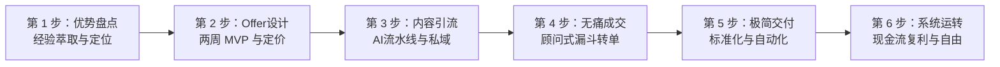

## 💡 为什么需要这套实战手册？

  

    
⚠️ 95% 副业创业者的死因：局部思维

    
很多技术人和职场精英能力极强，但离开组织后寸步难行——因为过去擅长的是<strong>庞大系统里的某项局部工序</strong>，从未从头到尾跑通一个包含「定位 → 获客 → 成交 → 交付 → 复利」的完整商业闭环。

  

  

    
🚀 ZenOPC 的解法：把自己变成商业系统

    
一人公司的核心，是从<strong>“完成任务的人”</strong>升级为<strong>“设计系统的人”</strong>。通过 AI 杠杆与无头自动化工具，让收入越来越依赖可持续运转的系统，而不是你实时在线的体力。

  

  
一人公司底层盈利公式 (Solopreneur Profit Law)

  
利润 = (高价值定位 × 信任资产杠杆 × 转化率) - 自动化极简成本

  

    只要定位精准、拥有不可替代的信任资产，哪怕只有 1000 个铁杆读者或 100 个付费客户，就能产生健康稳健的年现金流，实现真正的职业自由。
  

## 🗺️ 零基础小白的学习与落地路径

## 📊 真实中位数 vs 头部神话（拒绝幸存者偏差）

在开始之前，请先记住本书的核心立场：**用数据说话，不贩卖焦虑，不虚构暴富神话**。

| 发展阶段 | 头部神话叙事 (Top 1%) | 真实行业中位数 (Median) | ZenOPC 建议目标 |
|---|---|---|---|
| **第一阶段：冷启动** | "上线 3 天赚 10 万" | 首月收入：$0 - $150 | 30 天内完成 MVP，拿到第 1 个付费客户验证 |
| **第二阶段：跑通闭环** | "单月裂变 10 万粉丝" | 付费转化率：1.2% - 2.5% | 积累 100 个高意向种子用户，跑通 10-30 单闭环 |
| **第三阶段：稳定盈利** | "年入千万，海滩度假" | 月净利润：¥15,000 - ¥45,000 | 建立稳定被动现金流，收入超过本职工作薪资 |

  
📖 全书贯穿实操线：林凡的 90 天转型闭环

  
为了让每位零基础读者都能学以致用，本书全程贯穿真实演化案例：<strong>林凡（32 岁前大厂工程师）</strong>，从盘点自身 API 与数据抓取隐性知识起步，拒绝做泛自媒体，锁定“独立站出海卖家数据自动化”极窄利基，设计 ¥1,999 的 DWY 交付方案。他在 90 天内零买量、仅凭 3 篇深度机制拆解长文与一张自动化诊断表，跑通了月入 ¥22,000 的可持续一人公司闭环。

