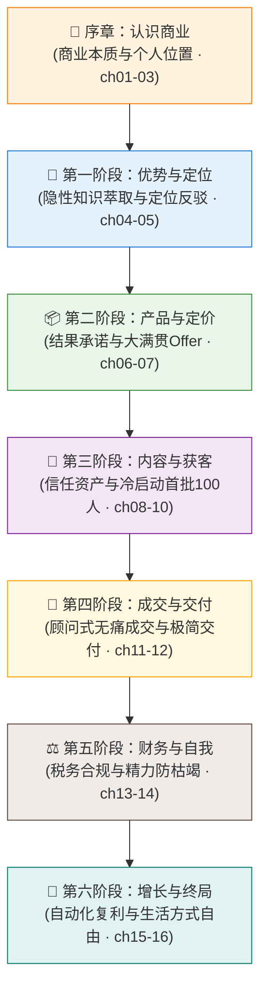

# 阅读导引 | 零基础小白如何从零跑通一人公司

> “不要试图先成为专家再开始创业，而是在解决具体痛点、服务真实用户的过程中，成为那个不可替代的超级个体。”

---

## 什么是一人公司 (One-Person Company, OPC)？

很多人对一人公司有两大误解：
1. **误解 A**：“一人公司就是街边摆摊或者低级代购？” —— **错**。街边小贩没有杠杆，用体力换单次收入。一人公司依托数字杠杆、内容资产与 AI Agent，具备极高的毛利率（通常在 80%~95%）和极强的自动化交付能力。
2. **误解 B**：“一人公司一定要注册成一家公司、租办公室、开发复杂的软件？” —— **错**。在验证商业闭环之前，一人公司甚至可以不需要实体办公室，一台电脑、一套工作流、一个个人微信即可启动。

**一人公司的精准定义**：
> 以单个创始人为决策核心，不依靠雇佣大量正式员工，通过专业判断力、数字产品、内容资产与自动化工具链，构建高利润率、高抗风险能力、可持续产生现金流的商业实体。

---

## 一人公司适合你吗？（小白自测三问）

如果你符合以下任何一种状态，本书就是为你量身定制的：

- **职场专业人**（程序员/设计师/运营/教师/律师/顾问等）：感到职业天花板逼近，厌倦了内卷与无意义汇报，希望将自己的本职经验转化为独立的第二收入曲线；
- **数字游民 / 自由职业者**：深陷“按时间接单卖体力”的恶性循环，客户一停收入就断，渴望将服务产品化，赚取睡后被动收入；
- **零基础副业探索者**（宝妈/转行者/大学生）：没有巨额启动资金，不敢冒巨大风险盲目开店或加盟，希望利用业余时间，零成本结合自身特点打造个人品牌与生意。

---

## 🗺️ 全书学习与落地路线图（八大阶段全景）

本书按商业闭环的自然演进规律编排，建议按顺序阅读；若已有副业实践，可直接跳入对应卡点章节：

---

## 小白执行的三大纪律（保命原则）

1. **纪律一：边读边写作业，拒绝“纯阅读快感”**
   - 商业知识不同于小说，光看懂是没有用的。每章结尾都有清晰的“验收标准”。读完一章，立即打开 Notion 或草稿纸，把本章要求的工作表（定位句、痛点清单、Offer方案）写出来。
2. **纪律二：严格遵照 [90天跑通闭环计划](/toolkit/90-days-action-plan)**
   - 90天足够跑通一个生意的最小闭环。不要在一两个环节上死磕一个月（比如花一个月选名字）。按周推进，未经验证的完美只是逃避被市场拒绝的借口。
3. **纪律三：直接调用 [高转化 Prompt 与模板库](/toolkit/templates-and-prompts)**
   - 我们已经为你调试好了针对 Claude、ChatGPT 和 DeepSeek 的全套商业提示词。不需要你凭空撰写复杂的文案，复制模板、填入你的背景，让 AI 充当你的麦肯锡商业军师。

现在，让我们翻到第一章，从最根本的问题开始：**商业的本质到底是什么？**
