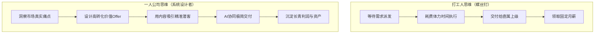

# ch01 商业的本质与个人位置

> **本章目标**：
> 1. 用“创造 → 交换 → 捕获”三段论彻底分清“作品”与“生意”的区别；
> 2. 理解 Naval Ravikant 的 4 大核心杠杆，明白为什么 AI 时代超级个体能以一人之力抗衡传统公司；
> 3. 完成思维跃迁：从“庞大系统里的执行螺丝钉”升级为“自己生意的系统架构师”。

---

## 真实对比：为什么技术好的人反而赚不到钱？

小张和小李是同一家大厂的前端工程师，技术水平不相上下。

- **小张（作品思维）**：
  业余时间花了 4 个月，死磕各种前沿技术，做了一个界面极度炫酷、动画丝滑的个人博客系统。他把项目开源在 GitHub 上，获得了 800 多个 Star，发在社交媒体上引来一片点赞称赞。小张很开心，但 6 个月过去了，这个项目除了给他带来几封“能不能加个功能”的 Issue 外，**没有产生哪怕 1 块钱的真实收入**。

- **小李（商业闭环思维）**：
  小李偶然在做跨境电商的朋友群里发现一个痛点：很多独立站卖家每天需要从国内货源网站抓取产品标题和描述，再找人工翻译润色成地道的小语种文案，人工翻译很慢且经常被境外客户投诉用词怪异。
  小李只用了 1 个周末，用非常朴素的代码调取 LLM API，做了一个专门针对“外贸产品多语言一键地道转译”的小工具。他挂出“包月 199 元、前 10 名早鸟 99 元”的简单页面，直接在卖家群里私信了几位老板。第一个月，小李收获了 18 个付费客户，净赚 2000 多元，且续费率超过 70%。

**为什么技术更炫酷的小张一分不赚，而代码简单的小李却能赚到现金流？**

因为小张只完成了**“创造”**，他在做**“作品”**；而小李跑通了完整的**“商业三段论”**，他在做**“生意”**。

---

## 商业的底层内核：三段论模型

商业的本质极度朴素，只有三个环环相扣的步骤，缺一不可：

```
① 创造 (Create)    ──▶做出对特定人群真实有用的东西（解决痛点或带来愉悦）
      │
② 交换 (Exchange)  ──▶对方在没有被强迫的情况下，自愿掏出真金白银与你成交
      │
③ 捕获 (Capture)   ──▶收入扣除交付成本后，能够为你沉淀可持续的正向利润
```

<div class="opc-grid">
  <div class="opc-card">
    <div class="opc-card-title">① 创造不等于商业</div>
    <p>点赞、收藏、转发、夸奖，本质上都只是<strong>“注意力”</strong>，不是商业。没有产生自愿支付的交换，产物就只是“作品”或“自娱自乐”。</p>
  </div>
  <div class="opc-card">
    <div class="opc-card-title">② 交换是商业的试金石</div>
    <p>客户嘴上说“这个产品真好、上线了我一定买”，不算数；只有当他真的掏出信用卡或扫码付了哪怕 10 块钱，商业的交换才真实发生。</p>
  </div>
  <div class="opc-card">
    <div class="opc-card-title">③ 捕获决定你能否生存</div>
    <p>如果卖出 100 块钱的东西，你的交付和时间成本折算下来高达 150 块，这不叫生意，这叫“做慈善”。一人公司必须拥有极高的价值捕获能力。</p>
  </div>
</div>

---

## 四个核心概念辨析（拒绝词汇混淆）

很多初学者容易被各种高大上的名词绕晕，我们用一句话把它们分清：

| 概念 | 本质定义 | 一人公司视角 |
|---|---|---|
| **生意 (Business)** | 一个能够持续自愿交换并产生利润的赚钱活动 | 你的某款产品化服务（如：为某类客户提供专属咨询） |
| **商业 (Commerce)** | 全社会所有生意相互连接、交换资源与价值的总系统 | 你所参与的外部市场大环境与规则网络 |
| **商业模式 (Business Model)** | 你是如何发现需求、组织资源、交付价值并赚取利润的完整逻辑设计 | 你通过什么方式获客、卖什么形态的产品、怎么实现自动化交付 |
| **生意人 (Entrepreneur)** | 能够识别未被满足的痛点、承担合理风险、调动资源搭建商业闭环的人 | 从“等待派发任务的打工人”转变为“自己生意的设计者” |

---

## Naval Ravikant 的 4 大杠杆与一人公司的时代红利

为什么过去一人创业极其艰难，而今天超级个体（OPC）能够爆发？答案藏在硅谷投资家 Naval Ravikant 提出的 **4 大杠杆理论** 中：

<div class="opc-diagram-container">
  
  <p class="diagram-caption">图 0-1：纳瓦尔商业四大杠杆矩阵（Naval's 4 Levers of Leverage）</p>
</div>


1. **劳动力杠杆（需要许可）**：管理员工是极其复杂且高摩擦的。一人公司主动**放弃**庞大的全职雇佣，消灭复杂的内部撕逼和高额薪酬负担。
2. **资本杠杆（需要许可）**：传统创业需要找 VC 融资，拿了投资人的钱就必须追求不可持续的狂热增长。一人公司**零融资启动**，拥有 100% 的决策自主权。
3. **代码与 AI 杠杆（无需许可）**：写出一段自动化工作流、配置一个 AI Agent，它们每天 24 小时不知疲倦地为你抓取线索、回复客户、处理交付。
4. **零边际成本内容杠杆（无需许可）**：你写的一篇深度干货长文、制作的一个实战模版，分发给 1 个人和分发给 10,000 个人的边际成本完全一样。

**结论**：
> 一人公司的秘密武器，就是**彻底放弃需要许可的劳动力与资本杠杆，将“代码与 AI”和“零边际成本内容”两大杠杆推向极致**。

---

## 身份跃迁：从“螺丝钉”到“商业架构师”

在大公司工作，就像生活在一个受控的温室里：水管有人接、肥料有人施、果实有人摘，你只需要专注把其中一片叶子擦干净。这种分工极大提升了工业效率，但也彻底废掉了个人直面荒野的生存能力。



当你从打工思维跃迁到一人公司思维，你关注的不再是“我今天忙不忙”，而是：
- **我的系统今天为我吸引了几个潜在客户？**
- **我的交付工作流中有哪些动作可以被标准化和自动化？**
- **如果我下个月去休假两周，我的收入系统会不会崩溃？**

---

## 一人公司全生命周期六阶闭环全景

一人公司不是散兵游勇的接外包，而是一台精密的商业机器。从零开始搭建你的个人商业系统，必须按顺序跑通以下六大核心阶段：


### 六阶闭环机理推演
1. **阶段 1：优势与利基定位 (Stage 01)**：通过隐性知识盘点与反驳测试，找到“市场痛点 × 个人天赋 × 交付杠杆”的极窄利基，拒绝在低价值红海中卷死。
2. **阶段 2：大满贯 Offer 与定价 (Stage 02)**：基于 Alex Hormozi 价值方程，将抽象技能封装为“结果承诺型产品阶梯”，打破“用时间换钱”的时薪天花板。
3. **阶段 3：信任资产与获客 (Stage 03)**：构建高信任微私域与内容引擎，用精准 Lead Magnet 替换泛流量泡沫，实现稳定高质量潜客涌入。
4. **阶段 4：医生问诊无痛成交 (Stage 04)**：放弃生硬推销，采用顾问式问诊流程，只对匹配度极高的人开具“处方方案”，达成零阻力高转化。
5. **阶段 5：AI 协同与极简交付 (Stage 05)**：建立标准化、模版化、自动化的人机交付管线，将周交付精力压缩至 15~20 小时内，守住四账户财税安全底线。
6. **阶段 6：复利杠杆与终局 (Stage 06)**：驱动“高毛利 ➔ 品牌心智 ➔ 杠杆复利”正向飞轮，自由选择“小而美现金流”或“高溢价资产化退出”。

---

## 🎯 本章自测与验收标准

<div class="opc-checklist">
  <div class="opc-checklist-title">本章掌握度通关检查</div>
  <ul>
    <li>【Explain 解释】你能否不用任何专业术语，向一个外行解释清楚为什么“有很多人点赞的项目不一定是一门好生意”？</li>
    <li>【Perform 辨析】审视你手头正在做的业余项目或过往想法，用商业三段论（创造/交换/捕获）判断它目前卡在第几步？</li>
    <li>【Transfer 迁移】指出你身边任意一个正在做自由职业的朋友，分析他目前主要依赖的是体力杠杆还是免许可杠杆？</li>
  </ul>
</div>
