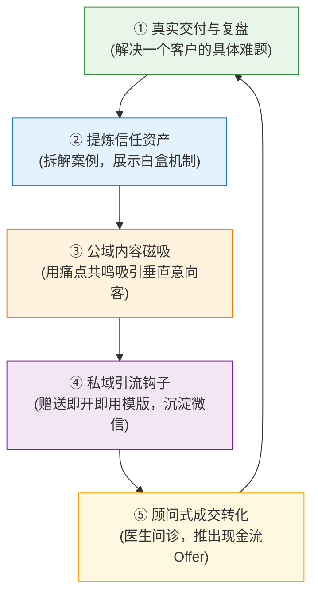

# ch03 商业化理论最小集与个人商业画布

> **本章目标**：
> 1. 掌握一人公司必须懂得的 3 个经典商业理论（个人商业画布、Teece 创新盈利机制、JTBD 需求理论）；
> 2. 学会用一张纸（个人商业画布 9 宫格）彻底厘清自己的赚钱逻辑；
> 3. 理解一人公司的“最小运转飞轮”，明白每个环节如何形成正向增强回路。

---

## 一人公司的三个底层理论工具箱

普通人不需要去读厚重的商学院 MBA 教材。对于一人公司而言，以下 3 个经典理论足以支撑你从零到百万营收的全部战略思考：

### 1. 个人商业模式画布（Business Model You）
亚历山大·奥斯特瓦德（Alexander Osterwalder）的《商业模式新生代》风靡全球，而《个人商业模式画布》将其微观化到个体。它用一张纸的 9 个格子，回答了一门生意的全部要素：
- **右半部分（对外创造价值）**：客户细分、价值主张、渠道、客户关系、收入来源；
- **左半部分（对内组织交付）**：核心资源、关键业务、重要伙伴、成本结构。

### 2. Teece 创新盈利机制模型（Profiting from Innovation）
著名战略学家 David Teece 提出了一个犀利的问题：**为什么很多原创发明家最终破产，而后来者却赚了大钱？**
因为单靠“创新/好想法”是不够的，你必须拥有**“互补性资产（Complementary Assets）”**（分发渠道、制造能力、客户信任、品牌知名度）。
- 对于一人公司：你的核心技能（代码、设计、咨询）是容易被模仿的；而你的**“个人品牌信任、私域客户关系、独特的交付工作流”**就是你不可被夺走的互补性资产！

### 3. JTBD（Jobs-to-be-Done）任务驱动理论
哈佛商学院克莱顿·克里斯坦森（Clayton Christensen）提出：**用户不是在“购买产品”，而是在“雇佣产品去完成某项任务”**。
- 客户买奶昔不是因为喜欢糖浆，而是为了早上开车通勤时解闷并不容易饿；
- 客户找你做咨询不是买你的时间，而是为了“在明天向领导汇报时不被当众挑刺”。

---

  
  
图 0-2：一人公司极简 9 宫格个人商业画布（9-Block Solopreneur Business Canvas）

### 画布核心 9 模块深度实操拆解

一人公司之所以能以单兵力量战胜传统团队，核心在于画布中九大模块的极端精简与免许可杠杆连接：

| 模块序号 | 画布模块 | 一人公司的落地准则 | 常见小白致命误区 |
| :--- | :--- | :--- | :--- |
| **01** | **微利基人群 (Customer Segments)** | 聚焦痛点明确、有支付预算的 1% 极窄人群（如“月入2万想转自由职业的高级前端”） | 贪大求全，试图服务“所有迷茫的年轻人”，导致面目模糊 |
| **02** | **无法抗拒的价值 (Value Proposition)** | 承诺确定性结果：“在 X 天内，帮你解决 Y 痛点，拿到 Z 成果，否则不收全款” | 卖抽象的时间、卖“陪伴”或“聊聊”，没有量化交付标准 |
| **03** | **极简获客渠道 (Channels)** | 专注 1 个核心公域长文阵地（建立专业信任）+ 1 个私域池（深度成交） | 同时注册 8 个平台，精力被算法和搬运彻底榨干 |
| **04** | **医生问诊关系 (Customer Relationships)** | 平等、专业、克制的顾问式关系；门诊预约制沟通，制定异步契约 | 卑微讨好、随叫随到，被客户当作廉价保姆随意呼来喝去 |
| **05** | **阶梯式收入流 (Revenue Streams)** | 免费钩子 (0元) ➔ 数字化入门品 (¥99~¥299) ➔ 核心咨询交付 (¥2,000~¥10,000) | 只有 9.9 元廉价课程（赚不到钱）或直接卖上万大单（转化不动） |
| **06** | **独门隐性资产 (Key Resources)** | 水下 90% 的行业踩坑教训、个人 IP 声誉资产、代码脚本与 AI Agent 工作流 | 误以为“会用 Office、懂点 Python”是资产，被 AI 轻易取代 |
| **07** | **高杠杆关键业务 (Key Activities)** | 每天只做三件事：**写高信任内容、做顾问式成交、迭代交付标准组件** | 整天沉迷于调网站样式、换名片、做 Logo、开无意义会议 |
| **08** | **AI与同行联盟 (Key Partners)** | 互补利基博主异业互推，深度利用 AI 智能体充当外脑与自动化流水线 | 盲目找人合伙分股权，或花重金外包给不靠谱的小团队 |
| **09** | **极简成本结构 (Cost Structure)** | 零办公室租金、零员工工资包袱，月软件订阅成本严格控制在 ¥500 以内 | 还没赚到 1 块钱，就先租豪华办公室、买昂贵工位和硬件 |

---

## 一人公司的最小运转飞轮（The Minimum Viable Flywheel）

一人公司的业务绝不是单向的一锤子买卖，而是一个能够自我强化的闭环飞轮：

1. **飞轮起步**：你认真交付了 1 个种子客户，获得了真实的数据、痛点和好评；
2. **飞轮加速**：你把这次交付的过程写成一篇深度的“机制展示”长文，公开分享你的思考；
3. **飞轮引流**：这篇文章吸引了 5 个面临同样困境的同行或潜在客户；
4. **飞轮转化**：他们领取引流模版后进入私域，向你咨询，其中 2 个人直接购买了你的付费服务；
5. **飞轮循环**：这 2 个人又为你提供了更新的案例素材，你的专业声誉进一步扩大。

**这就是一人公司越做越轻松、越做客户越多的复利本质！**

---

## 🎯 本章自测与验收标准

  
本章掌握度通关检查

  <ul>
    <li>【Perform 动手】下载或手绘一张个人商业画布，试着用铅笔把 9 个格子的初版写出来。</li>
    <li>【Explain 解释】向别人解释 Teece 的“互补性资产”为什么是一人公司对抗 AI 模仿的终极盾牌？</li>
    <li>【Debug 检查】检查你的收入来源一栏：是否只有单一的“按小时计费”，如果是，思考如何将其产品化为阶梯矩阵？</li>
  </ul>

