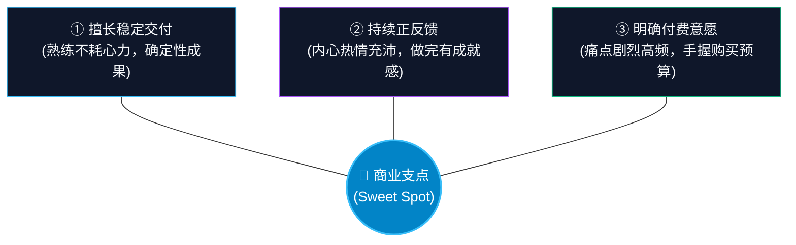

# ch04 挖掘自身优势与商业支点

> **本章目标**：
> 1. 打破“我没有一技之长”的冒充者综合征，用“三层冰山模型”萃取埋在水下的 90% 隐性知识；
> 2. 理解 Dan Koe 的超级个体核心命题：“解决你自己的问题，并把方案卖给两年前的自己”；
> 3. 完成《个人能力与隐性知识盘点表》，从模糊的爱好中提炼出市场愿意买单的优势支点。

---

## 零基础小白的最大卡点：我好像没有什么能卖的？

95% 的普通人在考虑做一人公司时，第一反应往往是：
- “我又不是行业泰斗，也没有名校光环，凭什么有人愿意付钱给我？”
- “我想做自媒体，但我看别人写得都比我好……”
- “我工作好几年，感觉自己什么都会一点点，但都不够精通。”

这种心理在心理学上被称为**“冒充者综合征（Imposter Syndrome）”**。
张飞宇在《把自己变成一门生意》中给出了一句醍醐灌顶的话：
> **“优势如果只停留在‘我喜欢什么’‘我好像擅长什么’这种模糊的感觉上，是没办法变现的。你必须找出那件你觉得太过简单、而别人觉得极度困难的事情——这就是你的支点。”**

你不需要成为全球前 1% 的专家才能开启商业化。**只要你比你的目标用户领先 2 步，你就能成为他最好的领路人。**

---

## 隐性知识萃取：三层冰山模型

传统职场人之所以觉得自己“没技能”，是因为他们只盯着冰山浮出水面的 10% 显性资产：

  
  
图 1-1：个人隐性知识三层冰山模型（The Tacit Knowledge Iceberg）

### 1. 行业暗知识（The Tacit Domain Knowledge）
在你的日常工作中，有哪些常识是你以为“大家都知道”，但一个刚入行的新手或外行听起来两眼一抹黑的“潜规则”？
- *例*：做过外贸跟单的人，一眼就能看出外商询盘邮件里哪些是骗子、哪些是真的采购商；
- *例*：做过招聘的 HR，一眼就能看出哪份简历是在堆砌套话、面试官最看重哪三个指标。
**这些外人无法从教科书上看到的暗知识，就是极高价值的咨询资产。**

### 2. 避坑与创伤（Trauma & Recovery Experience）
你过去 3~5 年里，在哪件事上交过了最惨痛的学费、浪费了最多的时间和金钱，但最终自己摸索着爬出来了？
- 你是如何从 0 到 1 转行成功的？
- 你是如何搞定一个刁难的甲方客户的？
- 你是如何在下班后兼顾育儿和自我提升的？
**Dan Koe 经典命题**：
> **你最好的目标客户，就是两年前的你自己。两年前你面临的绝望、困惑与痛苦，正是成千上万处于那个阶段的人正在经历的。把你爬出泥潭的完整路线图整理出来，就是最受欢迎的商业产品！**

### 3. 跨界怪癖与直觉（Cross-domain Stack）
Naval 和 Scott Adams 提出：**不要在单一领域死磕全球前 1%，而是把 2-3 个技能做到前 25%，利用交叉乘法实现唯一性**。
- 如果你只是“懂剪辑”，市场上有 100 万个剪辑师比你便宜；
- 如果你是“懂医疗行业术语 (前25%) + 擅长做科普短视频剪辑 (前25%)”，全网只有 50 个人能接牙科诊所的高客单代剪订单！

---

## 个人商业优势审计 5 问（The 5-Question Audit）

拿起纸笔，诚实回答以下 5 个问题：

| 提问维度 | 自测核心问题 | 你的挖掘记录与真实案例 |
|---|---|---|
| **1. 被索取审计** | 朋友、同事或网友最经常找你“顺便请教”或求助什么问题？ | *例：新同事总找我帮他们看汇报 PPT 怎么梳理逻辑* |
| **2. 呼吸级简单** | 哪件事对你来说像呼吸一样顺畅，但新手做起来极其痛苦抓狂？ | *例：快速拆解一份复杂的 Excel 表格并做成透视分析* |
| **3. 真实战果** | 在过往经历中，你帮自己或雇主达成过什么具体的数字指标？ | *例：通过优化流程，帮团队把每周发版时间从 3 天缩到 1 天* |
| **4. 无薪成瘾** | 即便没人给你发工资，你也愿意连续坐 6 个小时折腾的是什么？ | *例：折腾各种个人效率工具、整理书签和知识库* |
| **5. 痛苦逆袭** | 过去几年里你经历过最大的挫折是什么？你是怎么走出来的？ | *例：30岁从传统文员自学转行前端，整理了全套零基础笔记* |

---

## 警惕 4 大致命“伪优势”与 3 大“自嗨型利基”

很多零基础小白之所以一做就死，往往是因为把“自嗨”当成了“商业优势”：

### 4 大致命伪优势排雷
| 伪优势类型 | 典型自嗨表现 | 商业现实真相与杀伤力 | 修正方向 |
|---|---|---|---|
| **① 工具熟练度伪装成商业优势** | “我精通 Python / Figma / Notion / Midjourney” | 客户买的是业务结果，不是工具技能。工具是易贬值的显性成本，随时被 AI 平替。 | 转为：**用工具消除的具体业务痛点**（如：“用自动化脚本每天为外贸老板挽救 2 小时丢单风险”）。 |
| **② 消费型爱好伪装成交付专长** | “我爱喝手冲咖啡 / 喜欢心理学 / 热爱极简生活” | 纯粹的个人消费和审美愉悦，没有标准可量化的产出物，无法对他人产生确定性商业增益。 | 转为：**生产型避坑指南**（如：“帮独立咖啡馆降低 30% 咖啡豆损耗率的仓储清单”）。 |
| **③ 平台光环错觉伪装成个人能力** | “我在大厂操盘过千万级 DAU 项目” | 离开大厂的千亿基建、品牌信任、算法推荐与预算，个人连一个 50 人的付费微信群都建不起来。 | 转为：**独立单兵作战闭环**（剥离大厂资源后，你一个人能手动跑通的最小切片）。 |
| **④ 道德正确伪装成商业刚需** | “帮职场人早起打卡 / 戒除手机瘾 / 培养阅读习惯” | 典型的**“自虐型逆人性需求”**。人人都知道对，但全人类都在抵抗，付费意愿极低，弃单率 99%。 | 转为：**顺应人性的止痛方案**（不要帮他戒手机，而是帮他在必须用手机时 10 分钟搞定工作）。 |

### 3 大“自嗨型利基（避坑黑名单）”
1. **“穷幼老弱”低净值人群**：在校大学生、穷游族、找实习应届生。付费意愿低、对几块钱极端敏感、决策极慢、售后消耗极大。
2. **大红海泛知识类**：“大众通用情商提升”、“通用职场沟通课”。巨头和头部大咖垄断，流量成本极高，单价卷到 9.9 拼多多包邮。
3. **小清新/维生素类**：“生活仪式感营造”、“手帐排版美学”。人人点赞叫好，付款时“等下个月有钱再说”。

---

## 优势的商业判定公式：三环交集

  
一人公司商业优势判定定律

  
商业优势 = 可稳定交付的高质量结果 × 持续正反馈 × 明确市场付费意愿

  

    只有三者同时成立，才是一个合格的商业支点。只有前两者叫“爱好”，只有后两者叫“打工受罪”，只有一三叫“昙花一现”。
  

---

## 实操工具：个人能力与隐性知识盘点表

请使用以下模版完成盘点（可填入 3 个备选方向）：

| 维度 | 方向 A（如工作延伸） | 方向 B（如业余爱好） | 方向 C（如避坑经验） |
|---|---|---|---|
| **技能名称** | *例：B端产品原型设计* | *例：极简收纳与工位动线* | *例：零基础备考法考* |
| **解决的痛点** | 研发理解慢、需求反复改 | 远程办公者容易分心、疲劳 | 职场人时间少、抓不住重点 |
| **目标客户画像** | 5-20人的小型软件初创团队 | 高收入远程程序员与创作者 | 在职备考法考的非法学在职人 |
| **交付形式候选** | 1对1 原型评审 / 模板组件库 | 工位诊断改建方案 (DWY) | 100个必考法条记忆卡片库 |
| **市场付费证据** | 招聘平台经常有兼职原型需求 | 小红书工位改造贴互动高 | 每年几十万人报考，教材畅销 |

---

## 🎯 本章自测与验收标准

  
本章掌握度通关检查

  <ul>
    <li>【Perform 盘点】完整填写上述《个人能力与隐性知识盘点表》，至少列出 2 个候选方向。</li>
    <li>【Explain 解释】向别人陈述：你为两年前的自己设计了一款什么解决方案？解决了当时最痛苦的什么卡点？</li>
    <li>【Debug 筛选】检查你的候选技能：是否停留在“我喜欢画画”等模糊情怀上？如果包含，立即改写为“我帮某某解决什么具体痛苦”。</li>
  </ul>

