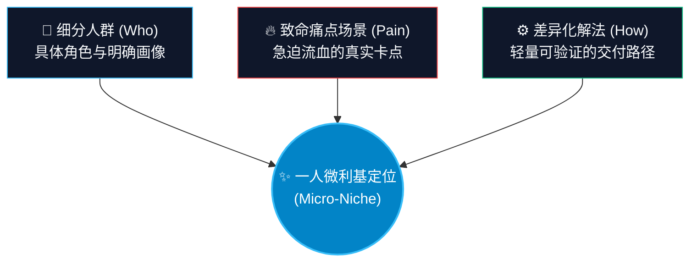
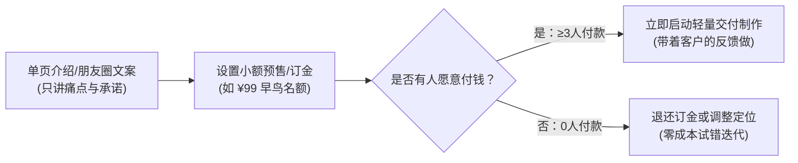

# ch05 找定位：一人定位三角与反驳测试

> **本章目标**：
> 1. 学会辨别真伪需求，理解为什么一人公司必须只做“止痛药”，绝不做“维生素”；
> 2. 掌握一人定位公式（人群 × 痛点场景 × 方法 → 确定性结果）；
> 3. 通过残酷的“定位反驳测试 4 道门”，在投入任何开发与制作之前，彻底验证定位的商业可行性。

---

## 需求的三层境界：为什么你只能做“止痛药”？

梁宁在产品思维中将用户需求分为三层，这对一人公司的生死至关重要：

| 层次 | 对应隐喻 | 用户真实心智 | 付费意愿与决策速度 |
|---|---|---|---|
| **痛点 (Pain)** | **止痛药** | “这事再不解决，我今天就要被辞退/损失几万块/痛苦崩溃” | **极高，不过度比价，快速成交** |
| **痒点 (Desire)** | **维生素** | “要是有这个东西，我会看起来更酷、生活更有品味” | **中等，反复犹豫，容易弃单** |
| **爽点 (Pleasure)** | **甜点/娱乐** | “用了立刻爽，不用也没啥关系” | **低-中，冲动消费，极易流失** |

<div class="opc-pitfall">
  <div class="opc-pitfall-title">小白常见自杀陷阱：做维生素型产品</div>
  <div>
    很多初学者喜欢做：“帮职场人读书做笔记”、“帮大学生提升自律能力”、“时间管理习惯打卡”。这些都是典型的“维生素”——人人都说好，但真正遇到收费时，用户会说“等下个月再说吧”。一人公司没有千万资金去教育市场，<strong>你必须直接扎进正在流血的伤口里，卖止痛药！</strong>
  </div>
</div>

---

## JTBD 任务模型：用户到底雇佣你的产品干什么？

克里斯坦森的 Jobs-to-be-Done 核心法则：**用户买的不是产品，而是他想要实现的“自身进步”**。

```
情境 (When...) ──▶ 障碍与动机 (I want to...) ──▶ 期望进步 (So I can...)
```

- **错误的需求描述（功能视角）**：“我做了一个 AI 自动发邮件的软件，支持 10 种语言。”
- **正确的 JTBD 描述（任务视角）**：“当我收到境外客户的紧急询盘（情境），我想要在 10 分钟内给出专业无瑕疵的商务回复（动机），这样我就能不被同行抢单、稳稳拿下一个月 5 万美元的订单（进步）。”

用户买的不是“AI 发邮件功能”，用户买的是**“不被同行抢单的安全感与订单收入”**！

---

## 一人精准定位公式：三环定位模型

一人公司的定位必须同时满足三个维度的约束：




<div class="opc-formula">
  <div class="opc-formula-title">一人公司标准化定位声明公式</div>
  <div class="opc-formula-body">
    我帮助【细分人群】，在【具体场景】下通过【核心方法/系统】，在【明确时间】内实现【确定性结果】，而无需【常见痛苦阻力】。
  </div>
  <div class="opc-formula-desc">
    定位句里每一个词都必须是实体或可衡量指标，严禁出现“赋能、全方位、卓越、赋智”等假大空废话。
  </div>
</div>

### 正反案例对比：

- ❌ **模糊无效定位**：
  > “我帮助职场人提升工作效率，用 AI 赋能日常办公。”
  > （*谁是职场人？提升什么效率？凭什么找你？没有任何购买欲望。*）

- ✅ **精准高转化定位**：
  > “我帮助 **刚从技术转岗做项目经理的工程师（Who）**，在 **每周需要向高管汇报但不知如何对齐（场景）** 的情况下，通过 **3套商业量化指标模板与汇报SOP（How）**，在 **2周内完成清晰汇报并消除被管理层质疑的焦虑（Outcome）**，而 **无需死记硬背枯燥的管理学大课（无需阻力）**。”

---

## 定位反驳测试：4 道残酷检验门

在写一行代码、录一节课之前，把你的定位句拿去过以下 4 道检验门。**任何一门没通过，立刻重写！**

<div class="opc-grid">
  <div class="opc-card">
    <div class="opc-card-title">🛡️ 1. 正规军测试 (Competitor Test)</div>
    <p><strong>核心反驳：</strong>如果有 5 人专业小团队做类似产品，凭什么客户选你？</p>
    <p><strong>通关标准：</strong>依靠真实亲历者人设、极细颗粒度的实操模版、以及大机构不屑于做的深度 1对1 关键节点纠偏。</p>
  </div>
  <div class="opc-card">
    <div class="opc-card-title">💳 2. 钱包深度测试 (Budget Test)</div>
    <p><strong>核心反驳：</strong>这群人手里有直接支付预算吗？还是到处白嫖的羊毛党？</p>
    <p><strong>通关标准：</strong>目标客户是手握预算的关键岗位职场人、自由职业者或小微店主，痛点解决直接关乎赚钱或止损。</p>
  </div>
  <div class="opc-card">
    <div class="opc-card-title">🌙 3. 凌晨两点原话测试 (Midnight Test)</div>
    <p><strong>核心反驳：</strong>你能否用客户凌晨发朋友圈的一句大白话还原痛苦？</p>
    <p><strong>通关标准：</strong>绝不使用“赋能、闭环、体系化管控”等空洞书面语，必须是“今晚改到两点，下周再搞不定就要扣绩效”的真实呼救。</p>
  </div>
  <div class="opc-card">
    <div class="opc-card-title">⚙️ 4. 单兵交付防爆门 (Capacity Test)</div>
    <p><strong>核心反驳：</strong>下周同时来 10 个客户，你的交付系统会不会直接崩溃？</p>
    <p><strong>通关标准：</strong>交付必须拥有标准化模版、异步沟通契约和明确边界，坚决杜绝无休止的“全天候随叫随到陪聊”。</p>
  </div>
</div>


1. **正规军测试**：大机构只能做标准化大通货；而超级个体可以做极度垂类、带真实人格温度、能 1对1 答疑的深度小众方案。你必须说出这个差异点。
2. **钱包深度测试**：学生、穷游群体、低收入摸鱼族往往没有预算，他们会把你的价格砍到地板上；而业务负责人、自由职业者、小微企业主手握预算，只要能帮他们省时间赚钱，几千元毫不犹豫。
3. **凌晨两点原话测试**：
   - *合格原话*：“今晚又改到两点，下周再搞不定外商审核我就要被扣绩效了！”
   - *不合格原话*：“需要加强质量体系管控。”
4. **单兵交付防爆门**：如果你设计的是“随叫随到全程陪聊”，来 5 个客户你就累倒在医院了。交付必须具备**标准化模版、异步沟通和边界清晰的约定**。

---

## 3秒利基筛选红绿灯法则

在确定方向前，用以下 3 个冰冷指标进行一票否决：

```
       [ 指标 1：预算痛感 ] ─── 对方手头是否有现成经营/保命预算？
               │
       [ 指标 2：流血时效 ] ─── 72 小时内不解决，是否会造成可量化金钱/职业惩罚？
               │
       [ 指标 3：单兵防御 ] ─── 一人手工能否交付？大机构是否因体量太小而不屑于做？
```

| 信号等级 | 判定标准（满足条件） | 商业行动指令 | 典型方向案例 |
|---|---|---|---|
| **🔴 红灯 (立即枪毙)** | - 目标人群无独立经济来源或手头无预算；<br>- 痛点拖延 3 个月生活毫无实质影响；<br>- 属于泛大众通用自我提升。 | **严禁立项**！投入任何时间都是纯度 100% 的浪费。 | - 大学生自律习惯打卡营<br>- 职场人情商沟通百题精解<br>- 新手手帐收纳指南 |
| **🟡 黄灯 (深度改造)** | - 有一定预算，但痛点并非迫在眉睫；<br>- 或痛点很痛，但目标人群过于宽泛，大厂竞品众多。 | **不准直接做！必须切窄 3 次**，切入具体 B 端角色或高危业务场景。 | - *改造前*：自媒体文案写作培训<br>- *改造后*：口腔诊所老板专属的本地同城获客短视频脚本模版（黄转绿） |
| **🟢 绿灯 (极速切入)** | - 目标人群手握明确预算（小老板/自由职业者/关键岗位职场人）；<br>- 痛点直接关乎赚钱、保命、合规、防被罚；<br>- 交付可用 1 张表格或 1 场诊断闭环，大机构看不上。 | **立即启动 14 天两周 MVP**！两周内必须拿到第一笔订金。 | - 亚马逊新手卖家防封店自检清单与申诉模版<br>- 刚转管理的研发组长：向非技术高管汇报的 3 套量化对齐模版 |

---

## 竞品空隙雷达：一人公司的侧翼战术矩阵

一人公司绝不要与正规军正面硬刚。大机构有四大致命死穴，正是超级个体的暴利金矿：

<div class="opc-grid">
  <div class="opc-card">
    <div class="opc-card-title">🏢 机构正规军盲区（大厂死穴）</div>
    <ul>
      <li><strong>大而全通识教材：</strong>理论层层抽象，离真实落地隔着十万八千里</li>
      <li><strong>冷漠录播课：</strong>单向灌输无真实互动，学员完课率不足 5%</li>
      <li><strong>庞大营收门槛：</strong>年营收几千万以下的小众利基市场完全看不上</li>
      <li><strong>企业公关包袱：</strong>讲究政治正确与品牌体面，绝不敢讲行业暗知识与潜规则</li>
    </ul>
  </div>
  <div class="opc-card">
    <div class="opc-card-title">⚡ 一人公司突围侧翼（暴利金矿）</div>
    <ul>
      <li><strong>极小颗粒度：</strong>直接交付改好的可运行代码、配置与发开发信模版</li>
      <li><strong>DWY 带着做：</strong>真人温度把关，关键节点录屏纠偏，结果确定性极高</li>
      <li><strong>极致微利基：</strong>只抓 100~300 个核心客户，年净利 50 万滋养自由人生</li>
      <li><strong>披露行业暗知识：</strong>刚爬出泥潭的实战黑客视角，无保留分享血泪避坑经</li>
    </ul>
  </div>
</div>


1. **颗粒度降维**：大机构教《品牌营销战略通论》（卖 1999 讲概念），一人公司卖《独立女装买手店开业前 7 天朋友圈发售剧本》（卖 2999 给直接抄的模版）。
2. **交付形态升维**：竞品是 50 小时录播课（客户看完还是不会做），一人公司提供“你填好前 3 个格子，我花 30 分钟录屏帮你逐行把关改好”。
3. **身份共情降维**：行业大佬站在山顶俯瞰（讲长期主义大道理），一人公司是“两周前刚踩过坑、灰头土脸但总结出爬坑路径的同伴”。
4. **场景切片**：大厂做通用 CRM，一人公司只做“针对自由摄影师的飞书客户预约与自动追款自动化系统”。

---

## 冒烟测试：写代码前拿到第一个付钱信号

在花费数周制作产品前，先做**“冒烟测试（Smoke Test）”**：



- **真实案例**：一位自由职业者想做一套“Freelancer 报税与合同模版”。他没有先花 2 个月写合同，而是做了一个 1 页的飞书文档，列出模版清单，在朋友圈发布：“下周推出，限时预售前 10 名仅需 ¥99”。
- **结果**：当天下午收到了 7 笔付款。他用这 7 笔付款作为最强动力，花了 3 天时间把模版整理交付。如果当天 0 个人买，他的试错成本只有半小时写文案的时间！

---

## 🎯 本章自测与验收标准

<div class="opc-checklist">
  <div class="opc-checklist-title">本章掌握度通关检查</div>
  <ul>
    <li>【Perform 撰写】用一人定位公式，完整写出一句属于你的一人公司定位声明。</li>
    <li>【Audit 检验】用“定位反驳测试 4 道门”逐一检验你的定位句，写下你通过每道门的理由。</li>
    <li>【Perform 原话】写出一句你的目标客户在遇到此痛点时，在社交平台可能会搜索或吐槽的大白话。</li>
  </ul>
</div>
