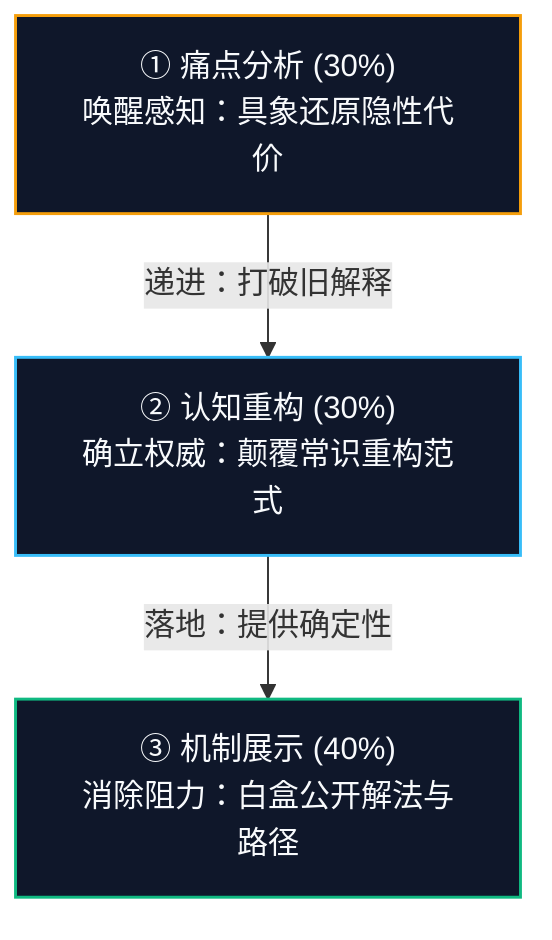

# ch08 内容的新角色：从流量到信任资产

> **本章目标**：
> 1. 彻底认清传统自媒体“泛流量逻辑”对一人公司的致命毒害；
> 2. 掌握“信任资产（Trust Assets）”的四层复利结构，明白为什么内容是一人公司最值钱的数字不动产；
> 3. 建立“三大内容支柱”（痛点分析 30% + 认知重构 30% + 机制展示 40%），让每一篇内容都自带商业说服力。

---

## 别再只做自媒体：泛流量对一人公司的致命毒药

许多想做一人公司的朋友，第一步往往是去买一堆“爆款短视频课”、“自媒体百万粉涨粉秘籍”。
张飞宇在《把自己变成一门生意》中开宗明义地警告：
> **“内容流量逻辑有巨大局限，一人公司别再只做自媒体！追求虚荣的曝光量，只会让你在算法的跑步机上活活累死。”**

传统 MCN 和泛自媒体的目标是迎合算法、追求播放量赚取平台的广告分成；而一人公司的目标是**筛选精准意向客户、沉淀商业信任、达成高客单转化**。

| 维度 | 传统自媒体“流量逻辑” | 一人公司“信任资产逻辑” |
|---|---|---|
| **核心指标** | 虚荣指标（播放量、点赞数、粉丝数） | 商业硬指标（精准留资数、咨询率、LTV、客单价） |
| **客群特征** | 泛娱乐、低门槛、无支付意愿的看客 | 高痛点、垂直利基、手握预算与决策权的买家 |
| **漏斗形态** | 漏斗灌水：100万曝光 → 1000互动 → 10人付费 | 窄管流淌：1000次精准触达 → 100人订阅 → 10人付费 |
| **边际成本** | 粉丝越多，白嫖咨询与客服成本呈指数暴涨 | 资产越厚，客户信任度越高，成交阻力越低 |
| **资产寿命** | 48小时后被算法淹没，断更即死亡 | 常青复利，1-3年后依然在通过搜索带来被动客户 |

<div class="opc-pitfall">
  <div class="opc-pitfall-title">为什么泛粉会毁掉一人公司？</div>
  <div>
    如果你的一篇泛娱乐段子爆了 10 万赞，后台涌进 500 条私信：“能免费发我吗？”“这也收费太黑心了吧”。一人公司没有外包客服团队，你必须亲自处理这些噪音，结果你一整天的时间被消耗殆尽，真正有付费能力的高端客户反而被淹没。
  </div>
</div>

---

## 信任资产的四层复利结构

一人公司既没有上市公司的大楼做抵押，也没有千万广告费做背书。**客户为你付费的最大阻力不是价格，而是对履约不确定性的恐惧**。
信任无法用钱买到，只能用工程化的内容资产来铸造：

<div class="opc-grid">
  <div class="opc-card">
    <div class="opc-card-title">🧩 4. 模块化转化零件 (Modular Assets)</div>
    <p>引流钩子 Lead Magnets、私聊异议库、落地页模块，一次沉淀，随处即插即用。</p>
  </div>
  <div class="opc-card">
    <div class="opc-card-title">🎭 3. 防伪人格与立场 (Contrarian POV)</div>
    <p>鲜明观点、个人签名风格、真实的失败数据与复盘伤疤，AI 永远无法模仿的人格防伪标记。</p>
  </div>
  <div class="opc-card">
    <div class="opc-card-title">🔍 2. 机制公开与白盒证据 (Show Your Work)</div>
    <p>流程全公开、SOP与案例实操录屏。客户买的不是秘密，而是确定性与执行标准，公开机制奠定权威。</p>
  </div>
  <div class="opc-card">
    <div class="opc-card-title">🏛️ 1. 意图锚定与常青指南 (Evergreen Guides)</div>
    <p>针对利基痛点的深度高密度指南，被搜索引擎和 AI 知识库长期收录，3 年持续带来被动精准客流。</p>
  </div>
</div>


1. **第一层：意图锚定（Search Intent）**：针对利基人群的高频痛点，撰写全网最清晰、结构最完整的长青指南。它们会被搜索引擎与 AI 知识库长期收录，持续 3 年为你带来被动精准流量。
2. **第二层：机制公开（Mechanism Disclosure）**：彻底打破传统中介“藏着掖着”的旧套路。**把你的工作流程彻底白盒化展示**：把模版、SOP、实操截图完整公开。客户付费买的从来不是秘密，而是你的执行速度与定制经验。公开机制反而确立了你作为行业标准制定者的地位！
3. **第三层：价值观与防伪人格（Contrarian POV）**：敢于亮出反共识的鲜明立场。记录真实的经营数据（Build in Public：真实收入、失败教训、退款复盘）。AI 可以生成千篇一律的完美套话，但**真实的伤疤与具体的数字是人类唯一的防伪标记**。
4. **第四层：模块化资产（Modular Assets）**：一篇深度长文可以拆解为引流工具包、落地页背书、社群答疑物料。创作一次，终身复利。

---

## 三大内容支柱：让内容自带推进感

一人公司的内容矩阵应严格围绕以下三大支柱按 **3:3:4** 黄金比例配置，彻底告别灵感焦虑：




### 支柱一：痛点分析 (30%) —— 唤醒共鸣
- **心理机制**：只有当客户确信“你比他自己更懂他的痛苦”时，他才会听你的建议。
- **公式**：`痛点共鸣 = 具象场景切片 + 表面症状还原 + 错误归因剖析 + 隐性代价算账`。
- **范例**：“你花了 3 个月把产品功能磨得尽善尽美挂在网上，每天后台却只有 2 个访客。你以为是自己没学投放，去买了 3999 的买量课，结果投了 5000 块只换来 3 个点击。问题不是你不会买量，而是你陷入了‘做完产品再找人买’的自杀式循环。”

### 支柱二：认知重构 (30%) —— 确立权威
- **心理机制**：给出打破直觉的底层逻辑，打破旧常识，提供全新视角，并建立专属概念。
- **公式**：`主流做法 (Common Sense) ──▶ 为什么在当前环境下失效 ──▶ 底层第一性原理 ──▶ 新范式命名`。
- **范例**：“所有营销大师都教你‘建立庞大的全网私域流量池’。但在 2026 年，微信加满 5000 泛粉是最大的负债。你每天花 4 小时群发，却无人买单。一人公司需要的是‘极窄信任管线’：放弃 99% 的泛互动，只保留 100 个精准决策者，用一张自动化诊断表替代 10 个私域社群。”

### 支柱三：机制展示 (40%) —— 消除怀疑
- **心理机制**：光有洞察只是评论家，给出落地解法才是专家。机制必须“白盒化、步骤化、具象化”。
- **公式**：`输入变量 ──▶ 处理黑盒拆解 (SOP/工具链/决策树) ──▶ 真实产出物 ──▶ 适用边界`。
- **范例**：详细附上 Notion 工作流截图、Prompt 调试过程记录、真实的 Stripe 结算后台看板，或者一个完整的代码脚手架与决策逻辑。直接展示具体指标与操作步骤。

---

## 小白人设降维：从“行业导师”切换为“先锋测试员”

很多初学者卡在不敢写文章，觉得“我又不是顶级大牛，凭什么指点江山？”。
请立刻放下好为人师的包袱，采用 GaryVee 的经典心法：**Document, Don't Create（记录真实过程，而非装大师）**。

- ❌ **行业导师视角（引人反感且心理负担大）**：“你们的方法全错了，今天我来给你们重构底层认知。”
- ✅ **先锋测试员视角（高信任且零门槛）**：“过去 30 天我花了 100 个小时把全网关于 XXX 的 5 类解法全测了一遍，踩了 4 个大坑，总结出一套普通人不用写代码也能跑通的自测表，今天把脱敏数据和过程全公开。”

---

## 手把手：小白第一篇高信任认知长文拆解模版

文笔普通、理工科思维的小白直接套用这套“镜头切换推进法”（1800~2500 字）：

```
[ 3秒黄金钩子 Hook (0-150字) ] ─── 反常识冲突结论 + 隐性代价算账 + 打破直觉的真凶
            │
[ 镜头 1：痛点切片 (400-500字) ] ── 4K还原深夜崩溃场景 + 情绪共鸣 + 为什么旧解法治标不治本
            │
[ 镜头 2：认知重构 (500-600字) ] ── 大众做法为什么失效 + 底层第一性原理 + 命名专属新范式
            │
[ 镜头 3：机制白盒化 (800-1000字)] ─ 3步执行骨架 + 工具/SOP截图 + 真实数据与适用边界
            │
[ 结尾行动呼吁 CTA (150-200字) ] ── 自主执行选项 + 现成工具包自取 + 零推销安全退路
```

### 填空式句式模版：
1. **Hook 开头**：“如果你还在每天花 3 个小时【大众正在做的低效动作】，听我一句劝：**立刻停下来**。过去 3 个月，我看到不下 20 位【目标人群】，为了【表面目标】花了【具体代价】，最后后台不仅 0 转化，还差点把自己累趴。问题不在于你不够努力，而是你一开始就掉进了【行业旧套路】的陷阱里。”
2. **镜头 1 痛点**：“想象一下：晚上 11 点，你坐在电脑前【具体动作】。心里想【客户内心原话】。很多人以为只要【常见错误自救】就能破局，但用战术勤奋掩盖战略残缺，只会越陷越深。”
3. **镜头 2 重构**：“行业里 90% 的人都会告诉你【主流常识A】。但在 2026 年，这反而会成为你的致命负债。商业的底层逻辑其实非常朴素：【一句话第一性原理】。我把这种新打法称为：**【专属新概念，如：极窄信任管线】**。”
4. **镜头 3 机制**：“为了验证这个逻辑，我在过去 2 周跑通了这套 3 步闭环：①【极简动作一+截图】；②【核心转化动作二+Prompt】；③【自动化收口动作三+真实看板】。注意：这套方案只适合【条件A人群】，不适合【条件B人群】。”
5. **结尾 CTA**：“你有充足时间完全可以照着自己搭；但如果你不想重复踩我踩过的坑，希望今天下午直接用现成模版跑起来：我把文中用到的【自查 Checklist / 计算器】整理成了一份资料包。在后台发送【关键词】无套路直接自取。”

---

## 主流阵地匹配度与《阵地选择象限图》

一人公司时间极度碎片化，**切忌全平台开花**！必须采取**“单母舰（深度沉淀） + 单探针（公域截流）”**的极简双核配置：

| 平台属性 | 内容门槛 | 算法寿命与复利 | 私域导流风控 | 一人公司契合度 | 角色定位 |
|---|---|---|---|---|---|
| **微信公众号** | 高（1500+深度长文） | 极高（私域常青资产、搜一搜） | **极低（天然闭环无封号）** | 深度思考者、顾问、技术/专业个体 | ⭐⭐⭐⭐⭐ **核心母舰** |
| **小红书** | 中（3-5张图文/无脸轮播） | 中等（搜索长尾 3-6 个月） | 极高（违规即禁言封号） | 视觉化工具、SOP、实用模版、泛职场 | ⭐⭐⭐⭐ **公域探针 (大众向)** |
| **知乎** | 中高（千字硬核答题） | 极高（百度/微信双索引，长尾数年）| 中等（专栏/主页合规可放） | 程序员、出海、硬核技术、B2B顾问 | ⭐⭐⭐⭐ **公域探针 (技术向)** |
| **X (Twitter)** | 低（Thread串、即时思考） | 低（48小时后被信息流淹没） | **零（允许直接挂外链与主页）** | 出海独立开发者、AI极客、Web3 | ⭐⭐⭐ **出海必备** |

> **决选法则**：
> - 泛知识/职场/效率方向：**【微信公众号（核心母舰） + 小红书无脸图文（公域探针）】**；
> - 程序员/技术/B端顾问方向：**【微信公众号（核心母舰） + 知乎精准问答（公域探针）】**；
> - 坚决不做：短视频口播与重度剪辑长视频，严防在算法跑步机上耗尽体能。

---

## ZenOPC 信任资产与精准转化全景漏斗

如何把三大内容支柱落实在具体的商业获客管线上？下图展现了从公域注意力、极窄私域筛选、黄金 72 小时培育，到最终医生问诊无痛成交的全景转化流：


### 转化漏斗四步推进逻辑
1. **01 公域注意力捕获 (Attention)**：依靠“痛点 Hook + 认知重构 + 机制展示”的三大支柱内容，在知乎、小红书、公众号、X 等阵地建立专业信任锚点。
2. **02 极窄私域筛选池 (Lead Magnet)**：用不可抗拒的实用模版或自诊断表（引流钩子），要求用户“主动索取”，以微行动完成精准客户筛选，主动剔除无效看客。
3. **03 黄金 72 小时培育 (Nurturing)**：Day 1 快速履约并附赠超预期赠礼；Day 2 剖析真实穿透案例；Day 3 观念对齐并破除心理顾虑，激活深度诊断需求。
4. **04 医生问诊无痛成交 (Conversion)**：不推销，只问诊。深度诊断卡点，开具处方化解决方案，匹配大满贯 Offer，实现高客单高满意度闭环。

---

## 🎯 本章自测与验收标准

<div class="opc-checklist">
  <div class="opc-checklist-title">本章掌握度通关检查</div>
  <ul>
    <li>【Audit 检查】翻看你过去发布的内容：有多少是在追求泛流量点赞？有多少属于可沉淀复利的“信任资产”？</li>
    <li>【Draft 选题】按照三大内容支柱（痛点分析、认知重构、机制展示），为你的微利基人群各写出 1 个切中要害的选题。</li>
    <li>【Explain 机制】为什么说“把自己的工作流程和模版完全白盒化公开，反而能卖出更高客单价”？</li>
  </ul>
</div>
