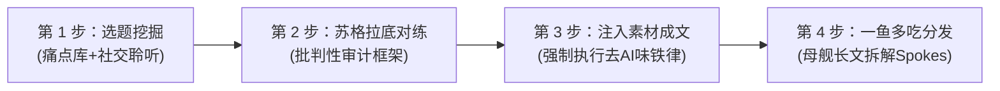
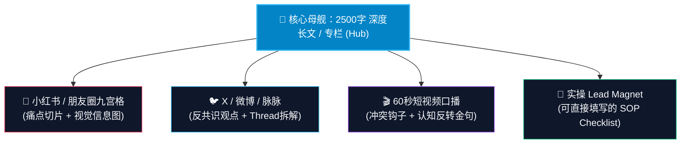

# ch09 用 AI 放大你的内容生产力：一人公司的内容工业流水线

> **本章目标**：
> 1. 打破把 AI 当“代笔枪手”的低效误区，建立个人 IP 数字第二大脑（Content Vault 4 大底表）；
> 2. 掌握端到端 4 步 AI 内容流水线与“写作去 AI 味铁律”；
> 3. 掌握 Hub-and-Spoke“一鱼多吃”全网分发引擎，将 1 篇深度母舰长文衍生为图文、Thread 与短视频脚本。

---

## 警惕伪生产力：不要用 AI 生成垃圾水文

2026 年互联网最大的灾难，就是充斥着大量由 AI 批量生成的套话垃圾：“在这个日新月异、飞速发展的时代，某某技术无疑扮演着至关重要的角色……”。
受众和搜索引擎一眼就能看穿这种毫无信息增量的废话。**如果你用 AI 批量生成水文，你摧毁的是你最宝贵的资产——个人信誉与专业尊严**。

张飞宇在《把自己变成一门生意》中强调：
> **“AI 越强大，人的差异性就越不会体现在谁更辛苦上，而会体现在：谁思考得更清楚，谁能更快地整合资源，谁能把能力更快转化为实实在在的结果上。”**

不要把 AI 当成“替你思考的枪手”，而要把 AI 当成你的**知识库索引员、批判性对练军师与多格式转换器**。

---

## 打造个人数字第二大脑 (Content Vault 4 大底表)

为了让 AI 产出具备你个人灵魂、充满真实细节的内容，你必须建立属于自己的**本地真实经验数据库**（可用 Obsidian 或飞书/Notion多维表格）：

  

    
📁 1. 真实故事与事实库 (/facts)

    
踩过的坑、交过的学费、真实的收入与失败数据、客户交付脱敏截图与原话，这是人类独有的事实凭证。

  

  

    
💡 2. 反共识观点库 (/pov)

    
对行业虚伪套路的理性批判、专属命名的方法论框架、与众不同的第一性原理判断与鲜明立场。

  

  

    
❓ 3. 痛点与异议库 (/objections)

    
真实咨询中客户问的所有问题、拒绝付费的真实顾虑、客户表达痛苦时的原生词汇与情绪黑匣子。

  

  

    
📚 4. 一手权威数据源 (/sources)

    
经典经济学论文核心论点、行业权威基准数据与口径、法律与财税条文原文、可反向索引的一手出处。

  

**这是 AI 永远在公开网络上抓取不到、无法伪造的独门防伪资产。** 每次创作时，把这些真实素材喂给 AI，产出的内容自然刀刀见血、充满真实质感。

---

## 端到端 4 步内容流水线 (Content Pipeline SOP)

### 第 1 步：选题挖掘
- 从你的“痛点库”中提取客户最近问过的真实问题。
- 让 AI 根据你的目标人群痛点，生成 5 个带冲突感、反直觉的候选标题。

### 第 2 步：苏格拉底式批判性对练
拒绝直接让 AI 动笔写正文。先让 AI 扮演一个挑剔的行业专家和质疑者：
> “我打算论述：‘一人公司绝不该招全职员工，而应全部微外包’。请站在反方立场，向我提出 3 个最尖锐的反驳案例。我需要如何限定适用边界，才能让这个论点无懈可击？”

### 第 3 步：注入个人真实素材与成文
把对练后的骨架，与你“事实库”里的真实案例（时间、具体数字、踩坑细节）结合，生成初稿。必须严格执行以下**去 AI 味铁律**：
- ❌ 禁用空洞副词：“至关重要、毋庸置疑、不可或缺、翻天覆地”；
- ❌ 禁用八股结构：“首先、其次、再者、总而言之”；
- ✅ 强制嵌入具体数字与人名场景；
- ✅ 句式长短交替，多用主动动词。

---

## Hub-and-Spoke 一鱼多吃全网分发引擎

一人公司没有时间天天针对每个平台单独写稿。以一篇 2000-3000 字的深度长文为**母舰 (Hub)**，利用 AI 瞬间衍生出 4 类子组件 (Spokes)：

1. **子件 A（小红书 / 朋友圈九宫格图文）**：
   - 提取文中的痛点场景作为封面大字卡片；
   - 提取机制步骤制成 3-5 页对比表格或视觉信息图；
   - 末页放行动召唤：“评论区回复【清单】获取可直接填写的模板”。
2. **子件 B（X / 微博 / 脉脉 Thread 串）**：
   - 首条放强烈的反共识结论；
   - 中间 5 条展示核心步骤与工作流截图；
   - 末条放母舰文章链接引导深度阅读。
3. **子件 C（60 秒短视频口播脚本）**：
   - 前 3 秒唤醒痛点：“如果你还在……那你每天正在白白损失……”；
   - 中间 40 秒给出 1 个反直觉的新解法；
   - 后 10 秒引导领取资料。
4. **子件 D（可执行 Lead Magnet）**：
   - 将文中的表格或 SOP 单独抽离为 1 份飞书/Notion 模板，作为本期的引流钩子。

---

## 🎯 本章自测与验收标准

  
本章掌握度通关检查

  <ul>
    <li>【Setup 搭建】建立你的个人数字第二大脑文件夹，写入至少 2 条你的真实踩坑经历或工作数据。</li>
    <li>【Perform 对练】使用 [苏格拉底对练 Prompt](/toolkit/templates-and-prompts) 与 AI 展开一次反共识观点的深度辩论。</li>
    <li>【Produce 产出】完成一次 Hub-and-Spoke 实验：把一篇深度长文成功衍生为 1 组图文卡片大纲与 1 份可下载模版。</li>
  </ul>

