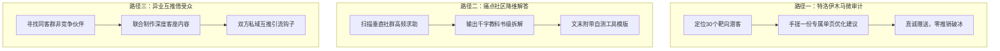
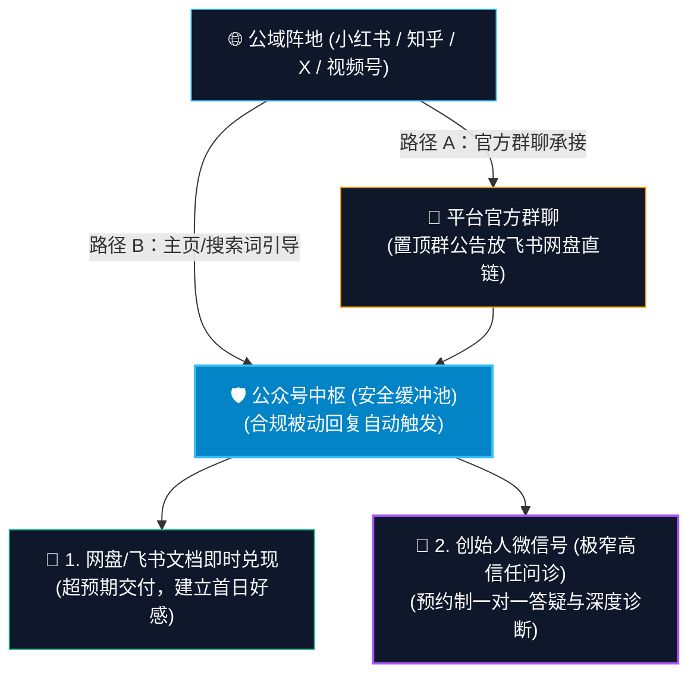

# ch10 冷启动获客与首批 100 个精准种子用户

> **本章目标**：
> 1. 掌握 0 粉丝、0 预算下的三大冷启动实战路径（特洛伊木马微审计、痛点社区降维解答、异业互推借受众）；
> 2. 学会设计“让人无法拒绝的高转化引流钩子 (Lead Magnet)”，打通公域到私域的自动化沉淀链路；
> 3. 掌握新客黄金 72 小时培育序列，亲签前 100 个付费种子客户并沉淀铁杆案例。

---

## 冷启动底层哲学：做无法规模化的事 (Do Things That Don't Scale)

保罗·格雷厄姆（Paul Graham）有一句创业名言：**“在起步阶段，做那些无法规模化的事。”**
很多初学者刚开始做一人公司，就幻想搭建一套全自动漏斗，自己躺在床上看客户自动刷卡付钱。在 0 到 1 阶段，这种想法必死无疑。

**冷启动期手搓一对一高摩擦沟通，根本目的不是为了赚暴利，而是为了达成三个核心战略目标**：
1. **获取最真实的用户原话 (Voice of Customer, VoC)**：他们到底用什么词痛骂现状？（这些词将成为你未来落地页和文章的最强标题）；
2. **极速校准你的 MVP**：看客户在使用你的服务时，究竟在哪个步骤被卡住、哪里发出惊喜感；
3. **沉淀第一批无可辩驳的真实证言 (Social Proof)**：这 10 个真实案例，将支撑你未来 1000 个客户的高转化。

---

## 三大冷启动实操路径

### 路径一：特洛伊木马微审计 (Trojan Horse Micro-Audit)
不要发推销信，而是**先为目标客户免费交付 30% 的高价值工作成果**。
- **操作 SOP**：
  1. 在社交平台或行业名录中，找到 30 个完全符合你微利基画像的潜客（如：刚上线不久但设计简陋的独立站站长）；
  2. 花 30 分钟针对他的公开页面进行深度体检，做出一份**《3处致命流失漏洞与优化建议单页》**（带修改对比示意图）；
  3. 私信发送：“Hi [姓名]，关注你的项目很久了。昨天浏览时发现这 3 处小细节可能导致你流失客户，我随手做了一份优化对比稿，放在这个链接里：[链接]。完全免费，没有任何推销，觉得有用直接拿去用！”
- **转化效果**：80% 的人会真诚致谢并主动展开沟通。此时你再顺理成章地提供：“如果你打算系统性把这套流程搭好，我正好有 3 个深度诊断名额……”，极高概率直接转化高客单！

### 路径二：痛点社区降维解答 (Community Authority)
既然自己没有受众，就去受众已经聚集的池子里（知乎、垂直微信群、知识星球、V2EX、即刻、Discord）借受众。
- **执行纪律**：**严禁在群里发推销海报和推广链接**！这会被秒踢且损毁声誉。
- **操作 SOP**：
  1. 看到有人发出高质量求助帖（如“为什么我的询盘转化率这么低”）；
  2. 不要敷衍两句，花 1 个小时写出全群最硬核、带具体步骤、带踩坑清单的**千字教科书式回答**；
  3. 文末留钩子：“篇幅有限，我把我自用的《完整自查 25 项清单与模版》整理成了 Notion 页面，有需要的朋友可以私信我自取”。
- 一篇顶级解答，能让你立刻成为整个社群眼中的绝对权威，引来数十个高意向用户主动加你好友。

### 路径三：异业互推与信任借贷 (Audience Borrowing)
寻找粉丝量在 1000-5000、同客群但**非竞争**的互补伙伴（例如：独立开发者 × 海外财税顾问；文案写手 × 网页设计师）。
- 共同举办一次线上 1 小时联名对谈或联合 Newsletter，将双方的引流模版打包赠送，相互背书，完成信任资产的双向过户。

---

## 高转化引流钩子 (Lead Magnet) 打造法则

传统的泛化资料包（如“500G 行业资料”）打开率低于 15%，不仅不能建立信任，反而给用户增加了认知负担。顶级引流钩子必须满足三大法则：

  
顶级 Lead Magnet 三大法则

  
窄而深 + 15分钟见效 + 痛点揭示器

  

    它只解决一个微小但剧痛的切片问题；客户能在 15 分钟内使用并拿到一个正反馈；同时在使用过程中，客户清晰地意识到自己存在一个更大的系统性漏洞，而你的付费方案正是唯一解药！
  

### 四大高转化形态：
1. **即开即用模版 (Template)**：预置公式的 Notion 看板、Figma 组件库、代码脚手架；
2. **高风险自查清单 (Checklist)**：上线前 25 项排雷核对表、合规红线自测表；
3. **3天行动微挑战 (Email Mini-course)**：每天一个 15 分钟最小练习，完成即有进步；
4. **AI 交互式诊断器 (Interactive Calculator)**：输入 3 个参数，即时生成个性化瓶颈体检报告（2026年最高转化形态！）。

---

## 杜绝 4 类无人问津的“假干货资料”

很多初学者花了整整两周做了一堆资料，挂出去却无人问津，核心死穴如下：

1. **大而全的百科全书（如“500页合辑”、“20G网盘包”）**：体积过大给用户造成巨大认知负债，放进网盘后永远不看；**没有阅读就没有信任**。
2. **纯概念理论科普（如“商业模式通识解析”）**：全网能免费搜到，缺乏行动触发器，看完依然不会做。
3. **无次生痛点暴露的自闭资料**：用户看完后觉得“没事了”，漏斗在此断裂，无法顺延到后端付费 Offer。
4. **见效周期超过 1 小时的作业**：需要用户配置复杂环境，90% 的人在第 10 分钟放弃。

---

## 5 类被验证的高转化一人引流钩子实战全案

  

    
📋 ① 排雷自检 Checklist

    
<strong>形态：</strong>上线或签约前 25 项排雷核对表，前 17 项帮用户解决初级问题，后 8 项埋伏系统性痛点并自然引导至付费方案。

  

  

    
🧮 ② 成本与 ROI 计算器

    
<strong>形态：</strong>参数化动态表单，用户输入 3 个数字即时算账，直观发现自己隐性亏损严重，亟需专业产品化重构。

  

  

    
💻 ③ 场景化实战 Prompt 库

    
<strong>形态：</strong>12 套去 AI 味工业级提示词库，附正反对比案例与输入槽位，复制即可在工作流中跑通。

  

  

    
🌲 ④ 二叉树决策清单

    
<strong>形态：</strong>接单、拒单、报高价的 5 个红线判定准则单页高清图，纠结时对照红绿灯，贴在工位直接指导决策。

  

  

    
📑 ⑤ 轻量自动化模板包

    
<strong>形态：</strong>飞书/Notion 开箱即用多维表格，预设好公式字段并附 3 分钟解说视频，让用户 5 分钟跑通首个流水线。

  

1. **排雷自检 Checklist**：如《独立站上线前必查的 25 个流失漏洞与合规红线核对表》。第 18~25 项埋伏系统性痛点，顺理成章引导至付费陪跑方案。
2. **成本与 ROI 计算器**：如《自由职业者时薪测算与外包 ROI 决策计算器》。用户输入当前目标月薪和工作小时，算完发现自己严重亏本，亟需产品化改造。
3. **场景化实战 Prompt 库**：如《拒绝套话：3分钟洗掉 AI 味的 12 个长文重构提示词库（附正反案例）》。直接提供带槽位的生产级代码块。
4. **二叉树决策清单**：如《自由职业接单决策二叉树：接单、拒单、报高价的 5 个红线判定准则》。单页高清图，贴在工位即可执行。
5. **轻量自动化模板包**：如《一人公司全自动线索收集与打标多维表格》。预设好公式与字段，配 3 分钟录屏，复制即可使用。

---

## 2026 最新公域到私域合规引流防封号 SOP

各平台对“私自导流”风控极严，切忌直接发微信号或谐音。采用分层合规漏斗：

1. **小红书群聊引流（最高存活率）**：小红书严禁私信微信号，但**大力鼓励创作者建官方粉丝群**。
   - 在个人主页建官方群（如“一人公司实战自检群”），干货笔记关联此群；
   - 群公告放网盘/飞书公开链接直接领资料；小号作为管理员入群（名字设为“答疑小助手”），发言“公式配置遇到异常可私聊协助排查”。
2. **知乎专栏与问答引流**：文末使用**知识沉淀缓冲法**：“因篇幅限制，完整动态表单整理在同名公众号【你的号名】后台回复【排雷】自取”。
3. **公众号满分高情商被动回复**：
   > “你好！你要的资料已经准备好了：🔗 链接 [飞书直链]（点击直接查看与复制，无需提取码）。  
   > 💡 建议使用电脑打开第 3 页核心表，10 分钟即可算出结果。  
   > 🤝 如果在跑流程时遇到卡点，欢迎添加我的个人微信：【你的微信号】（备注领域），我每天抽半小时亲自回复 3 个有深度的实战问题。”

---

## 黄金 72 小时培育序列 (Welcome Sequence)

用户领取引流钩子后的 **72 小时**，是其信任度最高的窗口期。必须建立 5 步自动化触达节奏：

| 时间节点 | 触达主题 | 核心动作与心理机制 |
|---|---|---|
| **D0 (即刻)** | **兑现承诺 + 惊喜彩蛋** | 3秒内发送资料，附带一个未提前告知的 3 分钟解说视频，超预期好感 |
| **D1 (+24h)** | **起源故事 + 伤疤暴露** | 讲述你曾经的失败经历（亏损/踩坑），暴露真实人格，反向筛选掉三观不合者 |
| **D2 (+48h)** | **硬核机制 + 深度认知** | 发送一篇代表作长文，彻底讲透底层逻辑，确立行业专业权威 |
| **D3 (+72h)** | **真实客户破局案例** | 详细拆解一个素人客户的完整逆袭过程，提供心理代入感与确定性背书 |
| **D4 (+96h)** | **低门槛行动邀请** | 提供一个限时低阻力体验（如 ¥199 入门指南或 15分钟一对一问诊预约） |

---

## 🎯 本章自测与验收标准

  
本章掌握度通关检查

  <ul>
    <li>【Perform 微审计】挑选 3 位符合你微利基的潜在客户，为他们每人制作一份 1 页纸的《微诊断优化建议》，并主动发送破冰。</li>
    <li>【Produce 钩子】制作出你的第一款高价值 Lead Magnet（自检表、模版或提示词库），并在公域内容中埋下软性领取入口。</li>
    <li>【Setup 流程】梳理你的新客黄金 72 小时培育内容，确保添加好友后有清晰的破冰话术与价值输出。</li>
  </ul>

