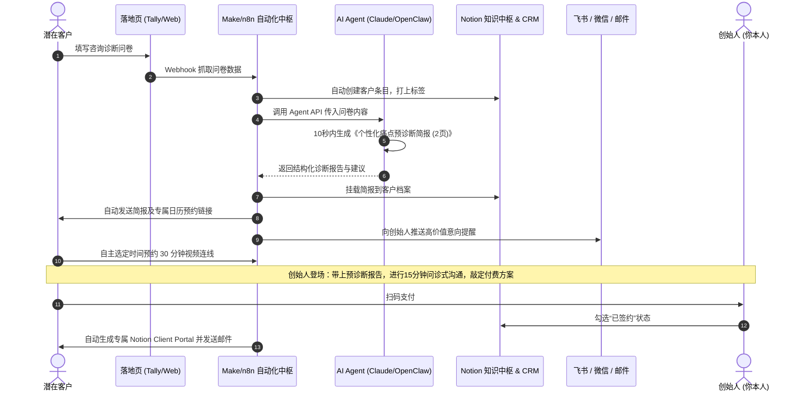
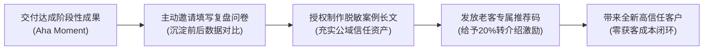

# ch12 规模化交付：一人服务多客户的四大能力

> **本章目标**：
> 1. 彻底解决一人公司“接单即爆仓”的物理瓶颈，掌握一人服务多客户的四大支柱（标准化、模板化、自动化、外包协同）；
> 2. 学会搭建专属 Notion Client Portal 异步交付中枢，消灭微信无休止的即时碎片消息绑架；
> 3. 部署现代 AI Agent 与自动化流水线，构建“交付即获客”的老客裂变引擎。

---

## 一人公司的终极物理诅咒：有单就爆仓，交付完断粮

很多独立咨询师和技术自由职业者经常陷入一种令人窒息的周期性怪圈：
1. **第一阶段（疯狂找单）**：手里没活，慌忙写文章、找客户、跟进线索；
2. **第二阶段（痛苦爆仓）**：运气好接了 3 个单子，每个客户随叫随到，被微信消息绑架，白天做交付，晚上改方案，连喝水的时间都没有；
3. **第三阶段（业务断层）**：交付期间完全没精力更新内容、沉淀客户。等单子交完，发现私域一片死寂，下个月收入直接归零，重新跌回找单焦虑。

**打破这一怪圈的唯一途径：停止手工肉身交付，建立一人公司的系统化交付工厂！**

---

## 一人服务多客户的 4 大核心能力

陈彼得在《AI+OPC：一人即公司》第 11 章中指出，一人公司必须构筑起 4 根刚性支柱：

  

    
📐 1. 标准化能力 (Standardization)

    
<strong>清晰边界，拒绝蔓延：</strong>严格推行客户前置输入协议（Client Intake），材料不齐不立项；明确交付清单与修改上限，杜绝在微信里随意索要增项。

  

  

    
📑 2. 模板化能力 (Templatization)

    
<strong>写过两次即成资产：</strong>任何文档写过 2 遍立刻固化为模版；常见问题被问过 3 遍立刻录制 3 分钟解说视频；为客户提供专属 Notion/飞书交付看板。

  

  

    
🤖 3. 自动化能力 (Automation)

    
<strong>通过巴士测试 (Bus Test)：</strong>付款自动发货、自动开通权限、自动发送日历预约链接。系统 7×24h 运转，创始人度假一周业务也不会停摆。

  

  

    
🧩 4. 微外包协同 (Micro-Outsourcing)

    
<strong>一人当元帅，外包当轻骑兵：</strong>创始人只做高价值核心决策与架构；视频切片、字幕对齐、图表美化等事务性工作按单微外包，绝不自己肉身硬抗。

  

### 1. 标准化能力 (Standardization)
- **输入协议 (Client Intake Sheet)**：客户付款后，必须先填写标准化 Tally / 飞书表单，一次性提交所有必需信息。材料不齐绝不启动项目，杜绝在微信里零碎追问。
- **刚性交付边界**：服务方案明确写清：“包含 2 次评审、交付 3 套标准组件；绝不包含任何未在清单内的定制需求”。消灭需求蔓延（Scope Creep）。

### 2. 模板化能力 (Templatization)
- **双重法则**：
  - 任何内容写过 2 遍，立刻沉淀为可填空的标准化模版；
  - 任何问题被不同客户问过 3 遍，立刻录制一段 3 分钟的 Loom / 腾讯会议解说视频，放入 FAQ 知识库。
- **专属 Notion Client Portal**：为每个付费客户建立一个独立的协作页面。项目里程碑、资料库、交付物下载全部集中在页面中，所有反馈异步处理。

### 3. 自动化能力 (Automation)
- **巴士测试 (The Bus Test)**：如果你生病或外出度假一周，现有的客户交付流程是否会自动停摆？
- 凡是“自动打标签、自动开通权限、自动发送日程预约链接、自动开具电子凭证”，100% 交由系统工具接管。

### 4. 微外包协同能力 (Fractional Outsourcing)
- 核心决策、关键逻辑判断、高价值沟通永远由创始人自己做；
- 低附加值操作（如：视频切片字幕校对、长图排版美化、简单数据录入）全部以按件计费方式，委托外部兼职人员处理。

---

## 警惕过度工程：自动化的“三跑原则”

一人公司新手（尤其是技术人）最容易患上的职业病是：**用技术配置的确定性，逃避商业获客的不确定性**。
在没有客户前，先花 3 周去配复杂的 Make / Zapier / Dify / 邮件系统，导致固定软件支出飙升且系统极其脆弱。

> **自动化铁律：三跑原则 (The Rule of Three Runs)**  
> 凡是任何业务动作，**在纯手工跑通 3 次之前，严禁接入任何自动化流水线！**  
> 1. 第 1 次：纯手工做，体会客户真实的卡点与情绪反馈；  
> 2. 第 2 次：整理成固定步骤的文字 SOP，看自己手工跑是否顺畅；  
> 3. 第 3 次：验证 SOP 步骤完全无歧义，交付成果客户满意；  
> 4. **第 4 次起**：仅将这套 SOP 中“机械、重复、无认知价值”的单点动作做自动化！

---

## 一人公司技术选型极简三步法

根据客户规模的演进，渐进式引入工具，消灭软件订阅黑洞：

| 演进阶段 | 核心目标 | 推荐最小可用工具链 (MVP Stack) | 自动化程度 | 月软件开销 |
|---|---|---|---|---|
| **阶段一：0 客户验证期** | 拿到第 1 个付费意向，验证痛点 | Tally.so / 飞书问卷 + 微信/腾讯会议 + 单个飞书/PDF文档 + 单个 ChatGPT/Claude 对话框 | 0% (全手工交付) | **¥0 / $0** |
| **阶段二：1~10 客户标准化期** | 消灭排期摩擦，固化资料容器 | Calendly / 飞书日历 + 单一 Notion 模板页 + 微信/Stripe付款码 + Claude Projects 知识库 | 20% (表单自动邮件确认) | **< ¥100 / 月** |
| **阶段三：10~100 客户规模期** | 自动化路由，创始人只做 20% 高阶决策 | n8n / Make + Notion Client Portal + Loom 录屏异步解说 + Dify 私有知识库答疑 | 70% (系统自转) | **< 营收的 3%** |

---

## 实战案例：端到端“高客单自动化交付”系统全景

以下是一个月入 10万+ 的超级个体真实的自动化交付业务时序：

  
传统团队 vs AI一人公司交付效能对照

  
耗时从 3 天缩短至 30 秒，人力成本降低 90%

  

    传统公司需要 1 个销售打排期电话、1 个助理收集材料、1 个分析师花半天写初稿。一人公司通过自动化智能体，在客户提交表单的 30 秒内完成全部预处理，创始人只需投入 30 分钟的高价值核心问诊！
  

---

## 现代一人公司人机协作自动化中枢

如何将自动化工具与现代 AI Agent 深度结合，实现边际交付成本递减？下图展示了创始人决策中枢与三大 AI Agent 集群协同工作的全景架构：

### 人机协同三大集群流转机制
1. **创始人决策中枢 (Core Brain)**：守住不可替代的护城河——战略定位与取舍、高阶共情问诊、内容洞察深度、终极审美标准与伦理声誉。
2. **集群 A1：内容与声量 Agent**：接管选题雷达扫描、长文结构化提炼与多平台图文切片脚本，持续稳定输送公域注意力。
3. **集群 A2：转化与线索 CRM Agent**：实现引流钩子秒级履约、潜客意向动态打标与 72 小时关怀序列触发，为创始人排期高意向客户。
4. **集群 A3：交付与产品 Agent**：自动拼装交付物初稿、7x24 小时基于私有知识库解答 80% 基础提问，并在关键节点回访收集口碑证据。
5. **基础设施底层**：通过 Make / Dify / 飞书 / Notion 等现代连接器将各环节打通，使一人公司的周有效交付工时控制在 15~20 小时内。

---

## 从“管家随侍制”升级为“专科门诊预约制”

为什么一人公司服务 5 个客户就可能精神崩溃？
- **传统错误模式（管家随侍制）**：客户随时在微信发语音弹窗，创始人秒回，白天被打碎成几十个 5 分钟碎片，无法深度交付；客户因信息散乱产生焦虑，变本加厉催促。
- **一人公司生存模式（专科门诊预约制）**：去三甲医院看专家门诊，患者必须提前挂号、在规定时段就诊，没人会觉得专家不专业，反而更加敬畏专家的权威与效率！
  1. **单一信息源原则 (SSOT)**：所有方案、修改意见、交付物沉淀在 Notion Portal，禁止在微信发送散落的 Word/PPT。
  2. **固定批复时间盒**：每天固定窗口（如 16:30 - 17:30）统一集中处理客户留言。
  3. **确定性进度里程碑**：启动首日公布 4 个检查点日期，客户催问自然归零。

---

## 一人公司异步沟通契约 (Communication Contract) 模板

在客户付款后、项目启动前，作为附录或第一条消息发送：

> **专属项目协同与沟通契约**  
> 尊敬的 [客户称呼]：为了确保能倾注最高密度的专注力为您交付高标准成果，我们采用高效的【结构化异步协作模式】：  
> 1. **唯一交付门户**：所有资料提交、阶段交付物与修改反馈，均统一沉淀在您的专属 Notion 项目主页（链接见文末）。微信仅用于关键节点备忘提醒。  
> 2. **集中回复节奏**：工作时间为工作日 09:30-18:00。为保证深度交付质量，设定固定集中回复时段：**16:30 - 17:30**。工作日留言均在 24 小时内得到深度书面回复。  
> 3. **紧急突发通道**：若发生直接影响业务宕机的重大阻断，可在微信发送【紧急求助：具体事件】，30 分钟未回可直拨紧急电话 [手机号]（常规方案沟通请走异步通道）。  
> 4. **修改轮次与时效**：每个里程碑包含 2 轮集中修改。交付后请在 3 个工作日内反馈，超期系统将自动推进至下一环节。  
> 👉 点击进入专属 Notion 协作主页并勾选确认：[链接]

---

## Notion 极简 Client Portal 标准骨架

每个付费客户 Duplicate 一个专属页面，收纳四个标准板块：

1. **项目状态看板**：M1 痛点确诊 (D+3) ➔ M2 核心方案 (D+7) ➔ M3 精细调整 (D+12) ➔ M4 结项归档 (D+15)；
2. **异步问题与修改反馈表**：包含字段【反馈所属模块】、【具体修改描述 (What & Why)】、【处理状态】、【更新方案链接】；
3. **共享知识与视频库**：嵌入 3 分钟 Loom 视频概览、输入资料归档、赠送的专属工具模版；
4. **结项交接与评价区**：全量资产永久下载直链、版权交接备忘、交付复盘问卷。

---

## 交付即获客：老客口碑裂变飞轮

优秀的交付不是商业的终点，而是下一轮获客的起点：

### 客户黄金证言提取 4 问（交付后第 7 天发送）
在客户初见成效的第 7 天微信发送：“占用你 3 分钟请教 4 个小问题，直接语音回复即可：
1. **【遇阻背景】**：找到我之前，你在该卡点上踩过什么坑、付出了什么代价？
2. **【决策顾虑】**：决定跟我合作前，最大的顾虑是什么？最终是什么细节让你下定决心？
3. **【顿悟与成效】**：合作中哪一个瞬间让你觉得‘太值了’？落地这一周，你的数据/效率发生了什么具象变化？
4. **【向他人推荐】**：如果向同行朋友推荐我，你会怎么向他描述这套服务？”

**老客双向激励机制**：为老客提供专属邀请码——**老客享 20% 现金感谢金（或抵扣进阶咨询费），新客凭码享 9 折首单特惠**。老客有面子、新客得实惠，实现零买量口碑转介绍。

---

## 🎯 本章自测与验收标准

  
本章掌握度通关检查

  <ul>
    <li>【Setup 搭建】为你的核心服务建立一个 Notion Client Portal 交付主页，包含输入清单、里程碑与交付资源区。</li>
    <li>【Automate 实验】用 Tally 表单 + 邮件自动回复，跑通一次线索自动沉淀与资料自动发送测试。</li>
    <li>【Audit 减负】盘点你过去一周处理客户消息的耗时，找出其中 2 个重复动作，将其改写为固定模版或 FAQ。</li>
  </ul>

