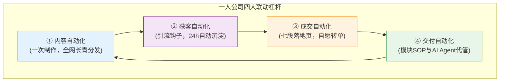

# ch15 系统运转：四大杠杆联动与复利飞轮

> **本章目标**：
> 1. 掌握内容自动化、获客自动化、成交自动化、交付自动化的联动机制；
> 2. 彻底打破“靠加人才能做大业务”的传统工业执念，学会用技术与流程构建单兵复利飞轮；
> 3. 理解现代一人公司的复利法则：越做越轻松、边际成本持续递减。

---

## 传统公司的扩张诅咒 vs 一人公司的复利飞轮

传统公司如果想把业绩从 100 万做到 1000 万，通常需要：
- 招募 10 倍的销售团队；
- 租更大的写字楼、购买更多办公设备；
- 设立部门经理、大区总监、HR与财务专员……
**结果是：收入涨了 10 倍，管理复杂度涨了 100 倍，固定开销居高不下，创始人的焦虑感和破产风险反而成倍增加。**

而一人公司追求的是**“不加人的增长（Growth Without Employees）”**！
张飞宇在《把自己变成一门生意》第 7 章中指出：
> **“最后一步是让系统替你干活——把内容分发、用户沉淀、成交转化的关键环节自动化，让一次制作的内容可以被复用若干次。四大杠杆联动，越做越轻松！”**

---

## 四大杠杆深度拆解与联动运转

### 1. 内容自动化：一次制作，百次分发
- **非自动化状态**：每天苦思冥想今天发什么朋友圈、明天发什么笔记，断更一天就流量断崖。
- **系统运转状态**：
  - 维护个人的“数字第二大脑”；
  - 每周只精雕细琢 1 篇母舰深度长文（Hub）；
  - 借助 AI 自动化流水线，在 15 分钟内将其切片为 5 条 Thread、3 组图文卡片、1 篇 Newsletter，并使用排期工具（如 Buffer、定时发布助手）全网分发；
  - 每一篇内容都打上特定的搜索关键词，持续在搜索引擎与 AI 知识库中沉淀为常青资产。

### 2. 获客自动化：沉淀私域，搭建引流通道
- **非自动化状态**：有人在评论区问资料，手动私信加好友，一个一个发网盘链接，半夜被弹窗吵醒。
- **系统运转状态**：
  - 在全网内容末尾埋入高价值引流钩子 (Lead Magnet) 暗号；
  - 评论区触发关键词，由自动化 Webhook / 机器人秒级私信发送链接；
  - 用户点击落地页，输入邮箱或扫码，系统自动通过邮件或机器人送达资源包，并在 CRM 中自动打上来源标签；
  - 整个过程你不需要实时在线，系统 24 小时为你捕获精准潜在客户。

### 3. 成交自动化：建立销售转化漏斗
- **非自动化状态**：每个客户进来，都花 2 个小时从头讲一遍“我是谁、我怎么做、多少钱”。
- **系统运转状态**：
  - 黄金 72 小时自动化培育序列：新用户进入私域后，系统在 D0、D1、D2、D3 自动推送预热内容、创始人起源故事、机制拆解与真实素人见证；
  - 用户在阅读完高密度内容后，已经被其专业性彻底折服；
  - 意向客户自主浏览七段落地页，通过在线日历预约专属问诊通话，或直接在线扫码购买入门级产品；
  - 创始人介入时，客户已经完成了 80% 的心智决策。

### 4. 交付自动化：模块化 SOP 与 AI Agent
- **非自动化状态**：来一个客户就重新做一套方案，手忙脚乱，随时爆仓。
- **系统运转状态**：
  - 客户付款后，系统自动为其开通专属 Notion Client Portal，发送标准化入职指引与输入表单；
  - 80% 的基础代码、排版、报告生成，由后台 AI Agent 在 1 分钟内跑完初稿；
  - 创始人只需投入 20% 的高阶判断与核心把关；
  - 结项后，系统自动触发满意度调查，引导老客户获取推荐分销码，开启新一轮转介绍。

---

## 飞轮效应：为什么一人公司会越做越轻松？

在商业初期，飞轮极度沉重：你需要花很大力气推它第一圈（盘点优势、写第一篇文章、手搓第一个客户）。
但只要第一圈转起来，**复利物理学就会开始发挥威力**：

  
一人公司复利公式

  

    边际成本持续递减 × 资产溢价持续攀升 = 自由度几何级扩张
  

  

    第 1 个客户可能需要你投入 20 个小时交付；第 10 个客户只需要你投入 5 个小时；到了第 50 个客户，你已经沉淀出完整的数字产品与自动化工具，交付时间压缩至 1 小时以内，而你的客单价却因为丰富的真实案例翻了 3 倍！
  

---

## 🎯 本章自测与验收标准

  
本章掌握度通关检查

  <ul>
    <li>【Map 映射】画出你目前业务的四大杠杆现状：指出当前最卡顿、最依赖你手动肉身操作的那个环节。</li>
    <li>【Automate 改进】针对上述卡顿环节，制定一个本周就能落地的自动化改进小动作（如用定时发布、或用自动化表单收集材料）。</li>
    <li>【Check 飞轮】检查你的新老客户回路：客户交付完成后，是否有机制能够自动产生新的好评见证或转介绍线索？</li>
  </ul>

