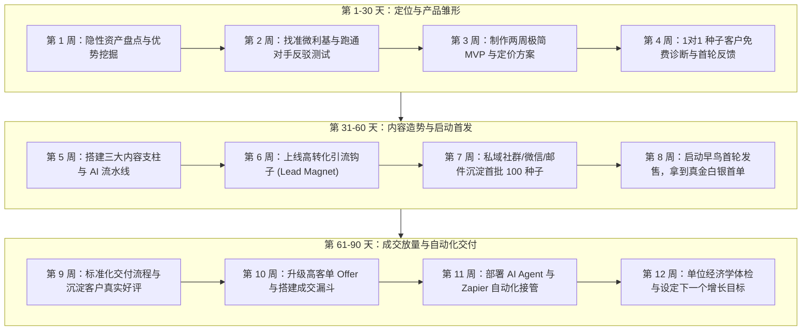

# 🗓️ 90天跑通你的第一个一人公司商业闭环

> **作战目标**：不空谈理论，不沉溺于完美主义。按照本周计划节奏，在 90 天内结合自身特点完成「优势定位 → 做出 MVP → 内容引流 → 跑通首单成交 → 搭建交付系统」，赚到一人公司的第一笔正向现金流。

---

## 🗺️ 90天全景作战路线图

---

## 阶段一：第 1 至 30 天 · 找准商业支点，做出第一版产品雏形

  
本阶段核心法则

  
不要先写代码或做大课，先验证有人愿意买单

  

    90% 的初学者死在闭门造车 3 个月做出一个自嗨的产品。前 30 天唯一的使命：用最低成本证明你的优势能够解决某个群体的真实痛点。
  

### 第 1 周：隐性经验萃取与优势盘点
- **核心任务**：
  1. 填写 [小白能力资产盘点表](/part1/ch04-demand#个人能力与隐性知识盘点表)，盘点过去 3-5 年工作中的高光时刻与隐性技能。
  2. 回答「优势挖掘 5 问」：
     - 别人经常向我请教哪类问题？
     - 哪件事对我来说像呼吸一样简单，但新手做起来极其痛苦？
     - 我帮前雇主/客户解决过什么具体的痛点、省了多少时间或赚了多少钱？
  3. 初选出 2-3 个具备商业潜力的技能候选。
- **本周交付物**：《个人优势与技能资产清单》（含 3 个备选方向）。
- **通过验收标准**：至少提炼出 1 个能用一句话清晰说明“帮谁解决什么痛点”的能力。

### 第 2 周：找准微利基与定位反驳测试
- **核心任务**：
  1. 使用一人定位公式拟定初版定位句：`我帮助【细分人群】，在【具体场景】下通过【核心方法/工具】，实现【明确结果】，而无需【常见阻力】`。
  2. 针对定位跑「对手测试」：列出市场上 3 个竞品或成熟前辈，回答“为什么客户应该找我而不是找他们？”
  3. 在微信朋友圈、即刻、小红书或推特发布一条「痛点共鸣帖」，观察是否有 ≥3 位潜在目标人群主动互动。
- **本周交付物**：1 句经受住反驳测试的定位语 + 10 个痛点关键词。
- **通过验收标准**：定位句中不包含虚词（如“赋能”“全方位”，只有可衡量的结果）。

### 第 3 周：制作两周极简 MVP
- **核心任务**：
  1. 严格执行「两周 MVP 纪律」：不做大系统、不录 50 节视频课。
  2. 将能力产品化为最低阻力的形态（三选一）：
     - **形态 A（轻咨询）**：1对1 深度诊断（60分钟，帮对方梳理一份可执行清单）。
     - **形态 B（服务包）**：Done-For-You 极简服务（如：3天帮你搭好专属知识库）。
     - **形态 C（模板包）**：即开即用的高价值模版/提示词库（如 Notion 模版 + 5套工作流）。
  3. 梳理交付清单与承诺结果。
- **本周交付物**：1 份单页 MVP 介绍文档（飞书/Notion/落地页），包含核心承诺、交付内容与价格。
- **通过验收标准**：可以在 3 分钟内让外行看明白你提供什么。

### 第 4 周：种子用户 1对1 免费内测与反馈
- **核心任务**：
  1. 寻找 3-5 位符合定位的目标用户，提供免费/互惠的内测交付。
  2. 在交付过程中录音或记录文字笔记，观察客户在哪里被卡住、哪里发出“哇”的惊喜感。
  3. 交付结束后进行 15 分钟回访，收集至少 2 份真实的详细评价和案例。
- **本周交付物**：3 份内测交付记录 + 2 份客户评价截图 + 1 份产品缺陷迭代清单。
- **通过验收标准**：至少 1 位客户主动表示“如果这个服务收费，我也愿意买”。

---

## 阶段二：第 31 至 60 天 · 用内容放大认知，启动首轮发售

  
本阶段核心法则

  
内容不是为了当网红，内容是为了沉淀信任资产

  

    一人公司不需要 100 万泛粉，只需要 1000 个认可你专业能力的精准潜在客户。内容是筛选器，不是大众娱乐。
  

### 第 5 周：搭建三大内容支柱与 AI 内容流水线
- **核心任务**：
  1. 确立内容三大支柱：
     - **支柱 1（痛点剖析 40%）**：直击目标用户的真实困境与认知误区。
     - **支柱 2（认知重构 30%）**：给出打破直觉的底层逻辑与新方法。
     - **支柱 3（机制与结果展示 30%）**：展示具体案例、拆解过程、工作流。
  2. 配置 AI 辅助创作工作流（利用 Claude/ChatGPT 批量拆解选题）。
  3. 制定每周发布节奏：每周 2 篇深度干货长文 + 3 条碎片思考。
- **本周交付物**：20 个精准痛点选题库 + 首批 3 篇已发布内容。
- **通过验收标准**：内容必须基于你真实做过的事情，不搬运毫无主观判断的二手套话。

### 第 6 周：上线高转化引流钩子 (Lead Magnet)
- **核心任务**：
  1. 放弃毫无吸引力的长篇泛化 PDF，设计一个**“狭窄但极致具体”**的引流钩子：
     - 如：《一人公司起步自检清单（含公式计算器）》
     - 如：《5分钟快速搭建 AI 个人工作流的 10 个核心提示词》
  2. 搭建自动化领取链路：公众号后台自动回复 / 飞书链接 / Notion 页面。
  3. 在已发布的内容文末埋入软性领取钩子。
- **本周交付物**：1 个高价值引流钩子 + 1 条自动化领取链路。
- **通过验收标准**：领取率在阅读者中达到 5% 以上。

### 第 7 周：私域沉淀首批 100 个精准种子用户
- **核心任务**：
  1. 通过内容互动、朋友圈分享、异业互推，把公域读者引导添加微信/企业微信/邮件列表。
  2. 为每一个添加好友的用户打好来源标签。
  3. 发送一对一破冰欢迎语：“很高兴认识你！目前在【某领域】遇到最大的卡点是什么？”
  4. 认真一对一回复前 50 个人的问题，建立高信任度的弱关系。
- **本周交付物**：私域沉淀精准好友达到 50-100 人。
- **通过验收标准**：能清楚说出其中至少 10 位读者的具体痛点与现状。

### 第 8 周：启动早鸟首轮发售，跑通第一笔现金流
- **核心任务**：
  1. 设计首发早鸟 Offer：提供限时折扣或专属附加权益（如限额 10 人）。
  2. 发布发售叙事朋友圈/邮件：讲述“为什么做这个产品 + 解决了什么问题 + 前期内测学员反馈 + 早鸟名额”。
  3. 针对私域中有过互动的高意向用户，进行顾问式私信沟通。
- **本周交付物**：首发宣传文案 + 真实收款记录。
- **通过验收标准**：**成功收到至少 3 笔真实付款**，跑通商业闭环！

---

## 阶段三：第 61 至 90 天 · 跑通成交路径，一人公司正式起步

  
本阶段核心法则

  
从体力交付升级为系统交付，构筑复利飞轮

  

    一旦跑通首单，不要立刻做新产品，而要把当前的交付打造成流水线，将个人精力从执行抽离，注入到系统的优化中。
  

### 第 9 周：标准化交付流程与沉淀客户好评
- **核心任务**：
  1. 将客户从付款到交付完成的每一步制成 SOP（入群、资料填写、交付日程、交付后跟进）。
  2. 制作标准交付模板库，减少 50% 重复打字与沟通成本。
  3. 在客户达成阶段性成果的最佳时机，主动邀请客户撰写好评与复盘。
- **本周交付物**：1 份《标准化交付 SOP》 + 3 份高质量客户案例好评。
- **通过验收标准**：单次客户交付耗时相比首单减少 30% 以上。

### 第 10 周：升级高客单 Offer 与搭建成交漏斗
- **核心任务**：
  1. 梳理产品阶梯：
     - 引流层（免费引流钩子）
     - 信任层（¥99 - ¥299 极简工具包/轻课）
     - 核心层（¥999 - ¥2999 陪伴式落地/交付包）
     - 旗舰层（¥5000+ 高端顾问/定制服务）
  2. 利用 Alex Hormozi 价值方程，增加高客单 Offer 的保障条款与赠品组合。
- **本周交付物**：1 份梯级产品矩阵图与价格表。
- **通过验收标准**：拥有至少一个客单价在 ¥1000 以上的成熟方案。

### 第 11 周：部署 AI Agent 与轻量自动化工作流
- **核心任务**：
  1. 盘点每日最消耗精力的机械重复动作（如：发货、打标签、线索收集、社交媒体排期）。
  2. 接入自动化工具（Notion + Make/Zapier，或专属 AI Agent），实现线索自动登记。
  3. 将个人知识库接入本地或私域 AI 智能体，自动回答 80% 的售前高频基础咨询。
- **本周交付物**：至少跑通 2 条自动化工作流。
- **通过验收标准**：每周为你节省 5 小时以上的琐碎工作时间。

### 第 12 周：单位经济学体检与设定下一个 90 天目标
- **核心任务**：
  1. 计算首个周期的单位经济学数据：
     - 总营收、净利润、总获客线索数、转化率。
     - 平均客单价、单客户交付耗时、时薪回报。
  2. 剔除低价值、高耗能的业务环节。
  3. 制定下一个 90 天的飞轮增长目标（如：拓展第二个分发渠道、启动老客裂变）。
- **本周交付物**：《一人公司首期经营复盘看板》 + 下一季度行动方案。
- **通过验收标准**：一人公司进入正现金流状态，成为你持续抗风险的个人核心资产。

---

## 🎯 90天执行打卡自测表

  
90天闭环里程碑通关检查

  <ul>
    <li>【D7】完成了个人隐性知识盘点，确定了至少 1 个可变现的优势领域</li>
    <li>【D14】定位句通过了 3 个同行的对手反驳测试，明确了微利基</li>
    <li>【D21】在 2 周内做出了第一版 MVP（咨询/服务包/模板），而不是空想</li>
    <li>【D28】完成了 3 位种子用户的真实内测，拿到了反馈与修改建议</li>
    <li>【D35】建立了 20 个痛点选题库，跑通了 AI 辅助长文创作流水线</li>
    <li>【D42】上线了一个可自动领取的强吸引力引流钩子 (Lead Magnet)</li>
    <li>【D49】私域精准沉淀了 50-100 位潜在目标客户，完成了初步破冰</li>
    <li>【D56】启动了早鸟发售，并成功收到了至少 3 笔真实客户付费</li>
    <li>【D63】交付流程形成了标准化文档，客户满意度良好并拿到证言</li>
    <li>【D70】搭建了高低搭配的梯级产品矩阵，包含了高客单核心 Offer</li>
    <li>【D77】用自动化工具接管了日常机械性动作，交付耗时减少 30%+</li>
    <li>【D90】完成了单位经济学复盘，一人公司开始自主转动并产生持续现金流</li>
  </ul>

